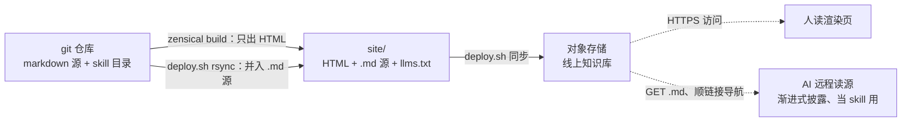

# 牛合天's wiki

用 [Zensical](https://zensical.org/) 构建、托管在对象存储上的个人知识库。

- **人看**：<https://wiki.liuhetian.work/> —— 渲染页，排版、导航、mermaid / ECharts 图、可玩的交互 demo 齐全
- **AI 读**：<https://wiki.liuhetian.work/index.md> —— 同一份内容的 markdown 源，顺相对链接一层层走进去，把整个 wiki 当**远程 skill** 用；<https://wiki.liuhetian.work/llms.txt> 是同一份首页源的 llms.txt 协议副本

这个仓库特别的地方只有一件事：**构建产物不只有给人看的 HTML，还有一份随线上一起发布的 markdown 源**。为什么这样设计、「对 AI 友好」如何立成可检验的标准（人可读 / 可获取 / AI 可读 / 可寻址 / 单源），详见[《用对象存储部署 AI 友好的个人知识库》](docs/projects/wiki/cos-deploy/index.md)。



机制上是一颗语法糖加两个写作约定：

- **语法糖**：[`deploy.sh`](deploy.sh) 里一行 rsync 把 `docs/` 的 `.md` 源树原样镜像进构建产物。`use_directory_urls` 让页面占 `/foo/index.html`，`/foo.md` 这个 key 正好空着 —— 人访问 `/foo/` 拿 HTML，AI 访问 `/foo.md` 拿同一份源，同域不撞、绝不双写
- **结构即 skill**：`docs/skills/` 按 [Anthropic skill 标准目录](https://platform.claude.com/docs/en/agents-and-tools/agent-skills/best-practices)组织（`index.md` + `reference/` + `assets/`），AI 顺 URL 读到的目录形态就是它熟悉的 skill 形态
- **代码即引用**：文章代码用 `--8<--` snippet 引用仓库里的真实文件，文档跟实际跑的代码不脱节

## 内容

六个顶层板块，各自的索引页就是入口：

- [文章](docs/posts/index.md) —— 一篇定义一个问题、提出解决方案，像一篇论文；论文笔记也是文章
- [项目](docs/projects/index.md) —— 为了交付同一个东西收在一起的问题，自己做的、拆别人的都算，一个项目一个目录；这个站点本身怎么做的，见 [wiki 介绍](docs/projects/wiki/index.md)
- [笔记](docs/notes/index.md) —— 概率与算法、统计学、机器学习、Git、JavaScript 等专业科目的学习与推导；可以用 git 冲突标记给自己出题
- [Gallery](docs/gallery/index.md) —— 原样收录的成品参考：图片配 prompt、排版、色彩、前端风格 demo
- [Skills](docs/skills/index.md) —— 给 AI 挂载执行的成套资产：FastAPI 后端、Dashboard 后台、数据可视化、前端画布、Agent 基础能力、HyperFrames 视频等
- [维护](docs/maintenance/index.md) —— skill、Gallery 收录和项目背后的事：选型实测、上游来源、吸纳来的 skill 改过什么

往这里写东西的规矩见[本 wiki 写作规范](docs/skills/wiki-guide/index.md)。

## 仓库结构

```text
docs/                 # 全部内容源；docs/index.md 是站点首页，也是 AI 的入口
├── posts/  projects/  notes/  gallery/  skills/  maintenance/
├── stylesheets/      # 全站令牌层 zx-tokens.css + 皮肤层 zx-theme.css + 首页 home.css
└── vendor/           # 本地化运行时，全部不走 CDN：React、three / r3f、MathJax、ECharts、Chart.js、Mermaid、GLightbox、Maple Mono 字体
overrides/            # 主题模板覆盖：首页开屏、按需引入 mermaid、页头指向 .md 源的发现链接
mkdocs.yml            # Zensical 兼容配置；nav 只是给人的策展层，不在 AI 链路上
deploy.sh             # git pull → 链路校验 → 构建 → md 源镜像 + llms.txt → 钉 Content-Type 同步 COS
deploy-cert/          # HTTPS 证书自动续期（acme.sh → DNSPod → COS API）
courses-src/          # 不发布：课程的参考解法与生成脚本
scripts/              # check-links.py（AI 链路闸门）、course.py（列出笔记里空着的自问题，以后也管课程的领题与归档）、lfs-cos-agent.py（自制 git-lfs 后端）、
                      # age-seal.sh / age-open.py（打码）、fetch-vendor.sh / build-fonts.py（升级 vendor 与字体）
```

## 本地开发与部署

**首次初始化**（新机器）：

```bash
GIT_LFS_SKIP_SMUDGE=1 git clone git@github.com:liuhetian/wiki.git && cd wiki
uv sync                          # 装依赖（Python ≥3.13）
# 放好 .env（见下）
bash scripts/setup-lfs.sh        # 接入自制 mini LFS（媒体真身在备份桶）
git lfs pull                     # 还原全部媒体（图/视频/字体/vendor 真身）
```

**日常**：

```bash
uv run zensical serve            # 本地预览
uv run zensical build            # 构建到 site/
python3 scripts/check-links.py   # AI 链路校验，部署时也会强制跑
./deploy.sh                      # 在部署机上跑：git pull --ff-only → check-links → 构建 → 同步到 COS
```

本地 commit、push 之后，在部署机的仓库根跑 `./deploy.sh`：它先 `git pull --ff-only`（有未推提交或冲突就停住，不静默合并），再构建并上传。图片等二进制媒体经 git-lfs 随 push 自动进备份桶、部署机 pull 时自动取回；机制与副机接入见[部署实操手册 · 资源备份](docs/projects/wiki/cos-deploy/reference/deploy.md#媒体备份)。

`.env` 需要（不入库）：`COS_BUCKET` / `COS_REGION` / `COS_SECRET_ID` / `COS_SECRET_KEY` / `COS_DOMAIN` / `COS_BACKUP_BUCKET`。前 5 项主桶用于部署；`COS_BACKUP_BUCKET` 是媒体真身的 LFS 桶（`lfs/` 前缀按内容寻址，见 [`scripts/lfs-cos-agent.py`](scripts/lfs-cos-agent.py)），与部署桶隔离。只写文字的机器可以不配 `.env`（`GIT_LFS_SKIP_SMUDGE=1` clone 后照常写、push）。

HTTPS 证书自动续期见 [`deploy-cert/install.sh`](deploy-cert/)，来龙去脉见[实操手册](docs/projects/wiki/cos-deploy/reference/deploy.md)。
