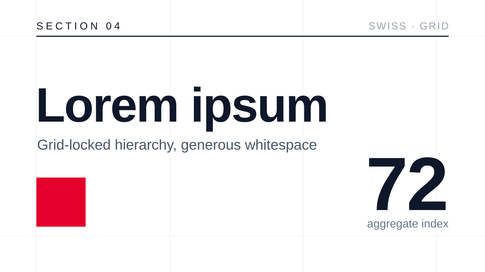
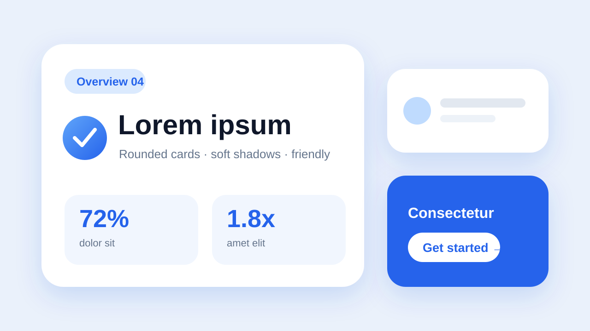
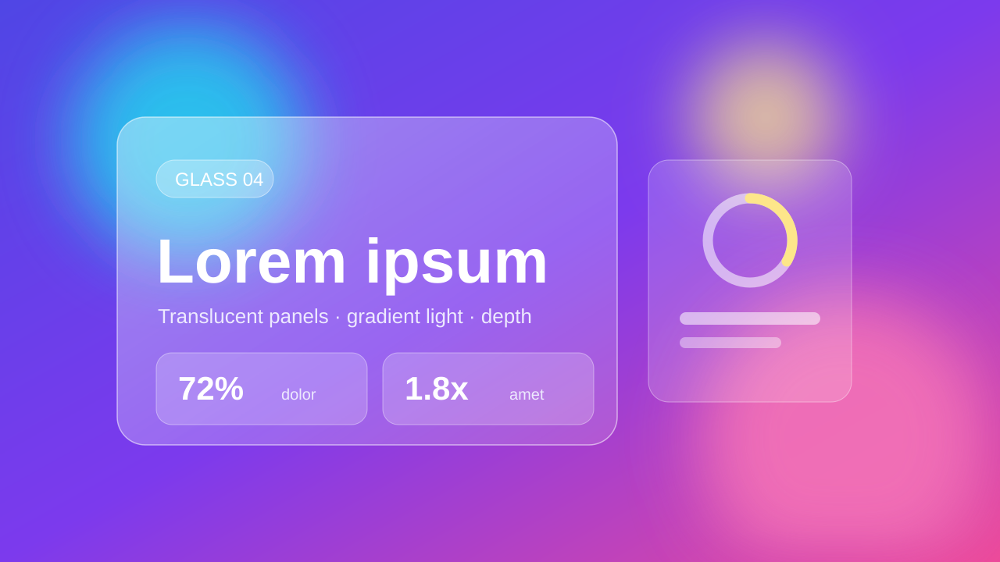
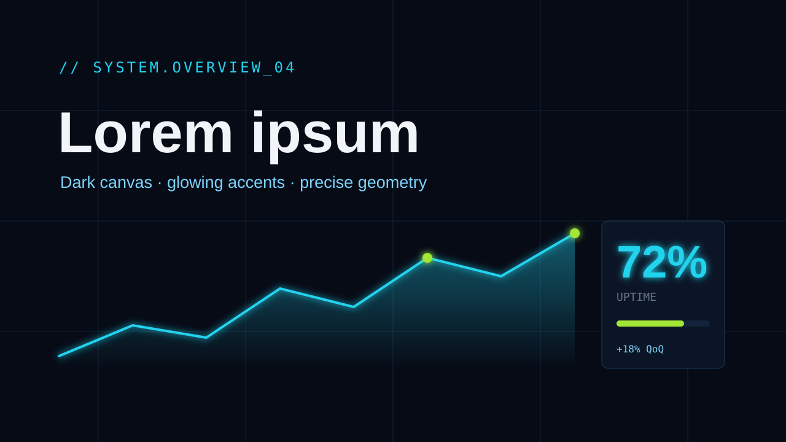
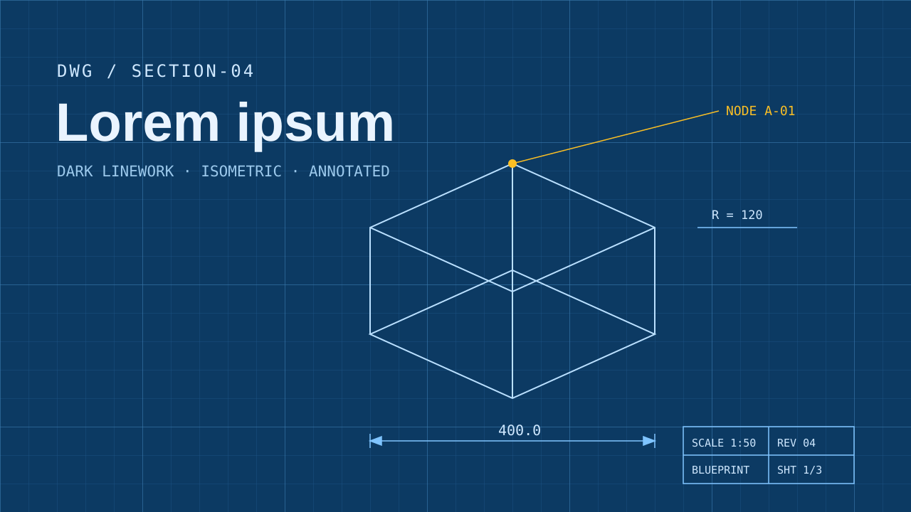

# PPT 视觉风格 · 企业与产品（5 种）

PPT 视觉风格里的企业与产品一组。视觉风格是什么、每条怎么读，看 [PPT 风格库](index.md#visual-styles)；怎么挑看[规划 deck](../../../skills/ppt-master/strategist.md#style)。每条不带色值，只管这套 deck 的配色怎么用；示意图是上游确认界面画的示意页，只示意版面气质。

### swiss-minimal · 瑞士极简 { #swiss-minimal }

网格锁定、利落，大胆留白，几乎零装饰 ｜ 配套画风：[瑞士极简](gallery-renderings-modern.md#minimalist-swiss) ｜ 插画分量：克制

严格的瑞士网格纪律：模块化网格、利落的几何、大胆的留白、几乎零装饰。最克制的一种风格，适合高端咨询、建筑、设计公司和以文字排版为主的 deck。

#### 形状与装饰

- 形状语言：偏爱利落、准确的形状轮廓，正圆，单一粗细的线，以及少量大面积几何平面。默认直角，圆角即使有也几乎看不出来。只要选中的轮廓有目的、准确、克制，PowerPoint 的整套形状都能用
- 构图手法：一块超大几何平面划分页面 —— 一根满高的色柱、一个巨大的圆、一条厚重的横条；非对称分割，内容贴齐一根轴线；建筑尺度的主视觉数字；一条斜线或一行字作为有意的破格。少、大、准 —— 海报尺度的几何是瑞士风，杂乱不是
- 装饰：没有信息或构图作用的装饰一律不要。不用装饰性渐变、装饰色块、徽章，靠结构撑起页面。承载内容的图片、插画、艺术字和形状，只要能强化这个结构，照样可以用
- 留白：大面积、有意为之，负空间和内容一样有分量。页边距宽，栏间距宽
- 版面贴合可见或隐含的模块网格，行列对齐严格

#### 字体性格

- 无衬线体，单一字族，靠常规体和粗体拉开对比。要用细体或特粗字重，得先确认放映的电脑装了那款字体。字距紧凑、严谨
- 字号层级鲜明：大标题，小而精确的正文。左对齐，齐左排

具体字体按主题挑，这种风格要的是怪诞体、新怪诞体那种性格，不是某一款字体。

#### 怎么用 deck 配色

- 主色可以划出一块刻意的网格区域，底子保持接近白色；强调色要收得够紧，读起来像标点而不是装饰
- 颜色是概念上的分区，不是装饰。不用渐变

#### 质感与层次

- 严格扁平。没有阴影、没有纵深、没有材质，只有二维的概念平面

#### 插画分量

克制 —— 留白和网格领衔。插画能让层级更锐利，或者造出一个有意的对照、又不侵蚀负空间时，才挑着用；尺度和位置跟着页面构图走。

### soft-rounded · 柔和圆角 { #soft-rounded }

圆角卡片，轻微浮起，平易近人 ｜ 配套画风：[扁平插画](gallery-renderings-modern.md#flat)；要毛玻璃那种纵深，看专门的[玻璃拟态](#glassmorphism) ｜ 插画分量：辅助

平易近人又现代。圆角卡片、轻微浮起、友好的节奏。适合产品、SaaS、培训、消费类 deck。

#### 形状与装饰

- 形状语言：明显的圆角矩形、胶囊标签、柔软的容器。全套 deck 的圆角半径保持同一个家族
- 构图手法：一个大的软圆或不规则色团从一边出血，作为色块底；用一串胶囊，或者 PowerPoint 自带的弧形、空心弧预设形状（`arc` / `blockArc`），代替装在框里的一排步骤；一块主面板压在一条满宽的浅色带上；一个超大的圆角数字垫在要点后面。预设形状画不准想要的轮廓时，才自己画弧线路径。卡片是容器语言，不是构图 —— 卡片下面的台子要变着花样
- 装饰：卡片是主要容器；图标点缀；带编号的圆；温和的分隔线。适度，为清晰服务
- 留白：卡片内边距舒适，栏间距均匀；求平衡，不求严苛

#### 字体性格

- 友好的无衬线体（人文或几何）；中等字重；层级清楚但不严厉
- 圆润、开阔的字形合适；避免窄体和工业感的字体

具体字体按主题挑，这种风格要的是平易近人的无衬线性格。

#### 怎么用 deck 配色

- 封面、章节背景上大胆用主题色；卡片底用同色相的浅色；关键数字用强调色
- 比瑞士极简、杂志编辑风用色更暖、更大方。按语义角色和视觉层级分配色相，有意为之的多色组合照样成立

#### 质感与层次

- 轻微浮起：浮动卡片带柔和阴影，浅色底，可选同色相渐变。浮起的层级保持浅、保持一致；同级网格里的卡片保持扁平

#### 插画分量

辅助 —— 选了插画时，友好的圆润元素可以在整套页面里承担锚点、辅助、节奏或温度。

### glassmorphism · 玻璃拟态 { #glassmorphism }

半透明玻璃面板，渐变光，漂浮的纵深 ｜ 配套画风：[玻璃拟态](gallery-renderings-modern.md#glassmorphism) ｜ 插画分量：克制

毛玻璃 SaaS 风 —— 深色底上层叠的半透明面板、流动的渐变光、漂浮的纵深。未来科技、轻盈、高级。适合现代 SaaS、金融科技、健康科技、产品发布、AI 演示。

#### 形状与装饰

- 形状语言：明显圆角的半透明玻璃面板（压在深色底上的低填充不透明度），带明亮的细线描边；层叠、漂浮的卡片，暗示模糊和磨砂
- 构图手法：一块主玻璃面板偏离轴线，压在一团径向光晕上；几个半透明圆叠出焦点簇；一个大玻璃圆环圈住关键指标；面板按纵深错开，暗示先后顺序；一道斜向光束穿过深色底
- 装饰：背景里柔和的径向光晕；面板边缘细细的发光高光；克制 —— 玻璃材质本身就是装饰，不额外加。径向光晕、发光光圈用 `<circle>` / `<ellipse>` 加 `<radialGradient>` 填充来画，绝不用 `rect rx=w/2` 凑数
- 留白：深色的负空间读作纵深；让面板漂在上面，留够呼吸

#### 字体性格

- 干净的现代无衬线体；常规体，挑着用粗体；通透。要用细体或特粗字重，得先确认放映的电脑装了那款字体。标题在深色底上可以带发光渐变

具体字体按主题挑，这种风格要的是干净、现代、通透的无衬线性格。

#### 怎么用 deck 配色

- 深色底；deck 的颜色化作流过面板和标题的发光渐变、低不透明度的玻璃底色，外加一个从属的霓虹强调色。颜色表现得像光穿过玻璃，而不是平涂
- 纵深和层级来自玻璃发光的亮度，不靠高饱和

#### 质感与层次

- 纵深靠半透明、层叠、明亮的边缘高光和柔和的背景光晕，不靠硬投影。顺滑的多段渐变是这种风格的本色（唯一一种大方用渐变才对味的风格）；保持发光感，别发浑

#### 插画分量

克制 —— 半透明面板、渐变光和漂浮纵深领衔。插画能改善构图、又不遮挡层级时，才挑着放在玻璃层里面、后面、旁边或横跨其上。

### dark-tech · 深色科技 { #dark-tech }

深色画布，发光强调，几何精确 ｜ 配套画风：[数字仪表盘](gallery-renderings-modern.md#digital-dashboard)或[蓝图线稿](gallery-renderings-modern.md#blueprint) ｜ 插画分量：克制

深色画布、发光的强调、几何的精确。适合科技、AI、开发者工具、数据产品、发布会。

#### 形状与装饰

- 形状语言：利落的几何；细细的发光线；六边形、电路、网格图案少量使用。转角可以是直角，或只带一点圆角
- 构图手法：一条发光的斜向电路线把页面一分为二；同心轨道环托起一个中心指标；一簇六边形节点映射各个组件；一个超大的低不透明度数字或字形浮在内容层后面；细细的括号框划分页面区域
- 装饰：发光点缀、细网格背景、等宽字标签、节点和连接线。克制 —— 精确胜过杂乱
- 留白：深色的负空间读作纵深；让元素漂在上面

#### 字体性格

- 正文用干净的无衬线体；标签、数字、代码提示用等宽字。小号大写标签字距放宽
- 在深色底上拉开高对比的层级

具体字体按主题挑，这种风格要的是干净无衬线配等宽字的组合。

#### 怎么用 deck 配色

- 深色背景；一小组克制的发光强调色通过发光的数字或激活的节点承载焦点，其余一律低调
- 强调色靠局部、高对比的使用来吸引注意力，而不是靠固定的出现次数

#### 质感与层次

- 纵深靠深色上的发光和层叠，不靠投影。外发光、亮色描边标出层级；渐变保持同色相、细微

#### 插画分量

克制 —— 发光点缀和几何精确领衔。插画挑着用，作为属于深色科技体系的焦点层或辅助层，而不是通用剪贴画；形态和尺度跟着页面要做的事走。

### blueprint · 蓝图 { #blueprint }

深色图纸上的示意线稿，等轴测，带标注 ｜ 配套画风：[蓝图线稿](gallery-renderings-modern.md#blueprint) ｜ 插画分量：辅助

工程示意图 —— 深色蓝图纸上的细线稿、等轴测投影、技术标注语言。说起话来像挂在墙上的图纸，而不是营销幻灯片。适合架构讲解、技术简报、工程白皮书、系统讲解。

#### 形状与装饰

- 形状语言：细的单一粗细线框（不用厚重填充）；组件画成勾边的几何；结构可选等轴测或三维轴测投影。圆角很小或没有
- 构图手法：让示意图就是版面 —— 一整页带标注的图纸当骨架，内容挂在引线上；一个圆形局部放大图连回它的出处；尺寸线括号框住主图；一个等轴测爆炸堆叠表现结构或顺序；图纸角落的标题栏压住一角
- 装饰：工程制图的词汇 —— 尺寸线、引线箭头、组件编号、坐标标签，底下垫一层淡淡的网格线。标注本身就是装饰
- 留白：让网格透出来；线稿以有分寸的间距漂在深色底上

#### 字体性格

- 标签和正文用干净的无衬线体；每个组件名、编号、坐标都用等宽字 —— 跟真实技术文档的读法一样
- 标注字小而精确；坐标、尺寸标签字距放宽。克制胜过强调

具体字体按主题挑，这种风格要的是干净无衬线配等宽字的组合。

#### 怎么用 deck 配色

- 深色图纸底；一种线色承担全部示意线稿（框、连线、边）；一个点状强调色标出当前状态、关键路径或标注 —— 工程制图里只用一种高亮色的老规矩
- 其余都是低调的线稿。强调色只出现在少数几处，高对比

#### 质感与层次

- 扁平线稿，不做材质上的浮起。纵深来自等轴测投影和分层的线宽，不靠阴影。深色图纸上可选很淡的角落暗角或强调色光晕 —— 保持很淡

#### 插画分量

辅助 —— 选了插画时，它的自然语言是示意线稿、标注记号，以及和蓝图对齐的透明元素，不管是用 SVG 画还是生成后切图。
