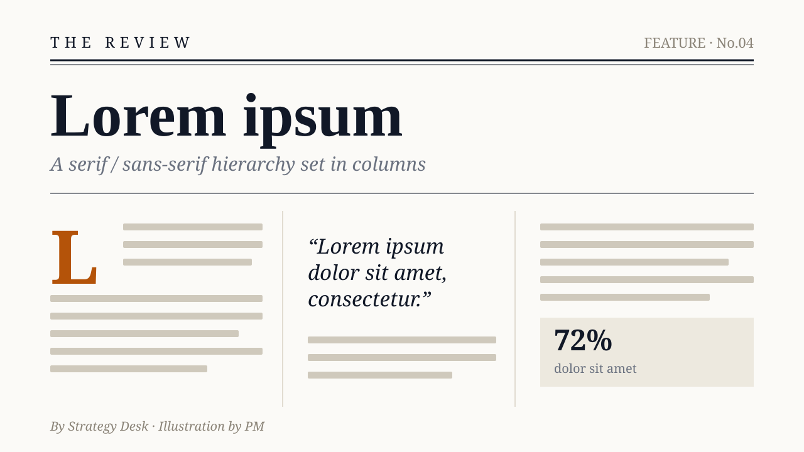
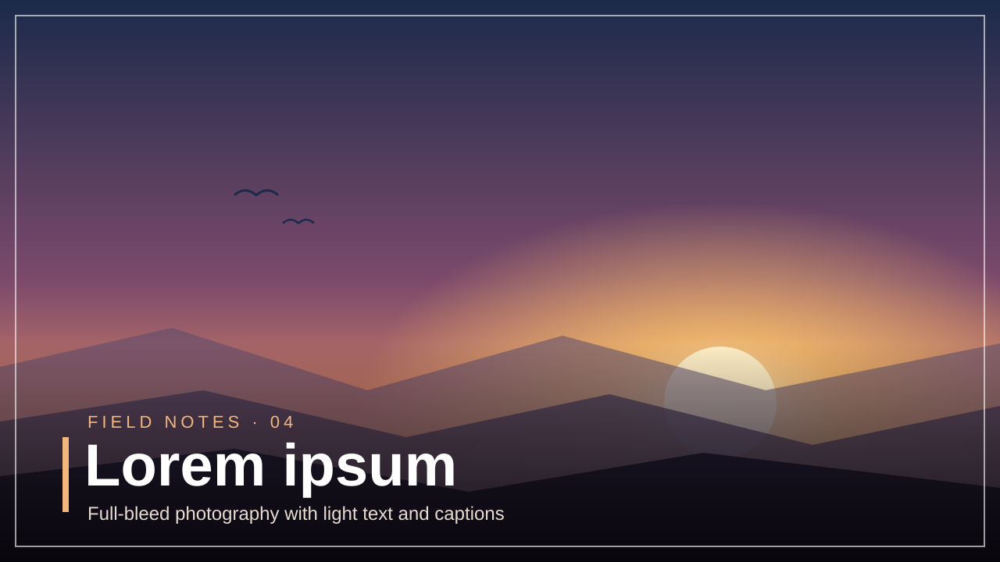
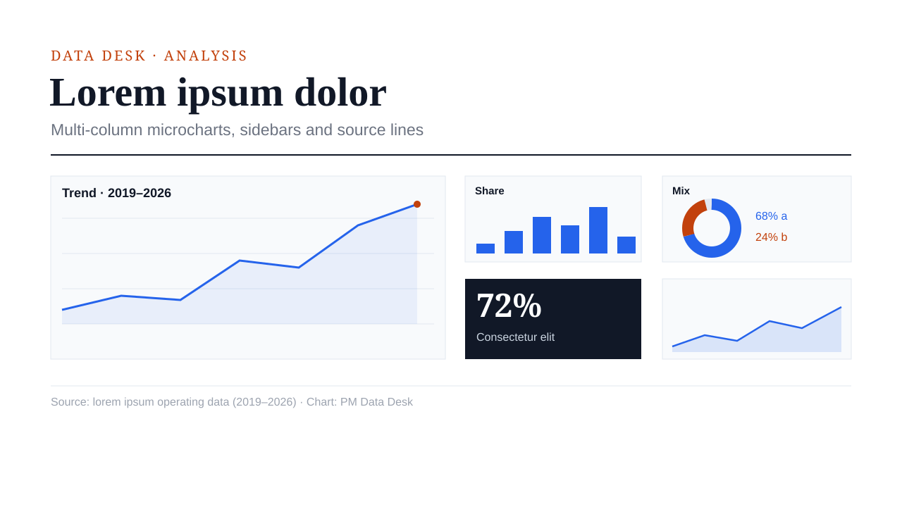
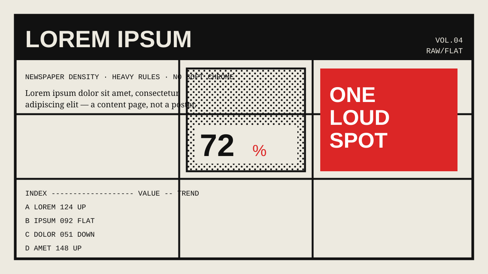

# PPT 视觉风格 · 编辑与出版（4 种）

PPT 视觉风格里的编辑与出版一组。视觉风格是什么、每条怎么读，看 [PPT 风格库](index.md#visual-styles)；怎么挑看[规划 deck](../../../skills/ppt-master/strategist.md#style)。每条不带色值，只管这套 deck 的配色怎么用；示意图是上游确认界面画的示意页，只示意版面气质。

### editorial · 杂志编辑风 { #editorial }

杂志式层级，细线与分栏，衬线与无衬线对照 ｜ 配套画风：[杂志编辑风](gallery-renderings-modern.md#editorial) ｜ 插画分量：辅助

杂志级的层级。分栏、细线、衬线与无衬线的对照、强烈的排版结构。适合金融、新闻、研究、长篇分析。

#### 形状与装饰

- 形状语言：横平竖直的编辑脚手架，偏爱细线和栏间分隔线，而不是一排排重复的卡片。勾边的、组合的或准确的形状，在能讲清归属、对比、顺序或强调时照样能用；克制管的是它们的视觉分量，不是形状的种类。圆角即使有，也要几乎看不出
- 构图手法：一个超大的首字下沉或数字压住页面；一段引语横跨几栏；一根满高的竖线，内容挂在它上面；非对称的分栏，而不是机械的等分；一张图有意越过栏边
- 装饰：细线、栏目眉题、引语、首字强调 —— 靠排版，不靠图形。点到为止
- 留白：由分栏和基线节奏组织；舒适但信息丰富
- 内容合适时用多栏文字流

#### 字体性格

- 衬线与无衬线对照：标题或引语用衬线体，正文用干净的无衬线体（或反过来）。角色对比清楚
- 强烈的纵向层级：眉题 → 标题 → 导语 → 正文。行距宽松

具体字体按主题挑，这种风格要的是编辑式的衬线 / 无衬线搭配，不是某几款字体。

#### 怎么用 deck 配色

- 浅色底上以单色文字为主；一个克制的强调色可以点出一根线、一个高亮数字或一个眉题
- 克制 —— 颜色标出结构和强调，不做装饰

#### 质感与层次

- 扁平到几乎不浮起。用线和留白分隔内容，不用阴影。只有真正漂浮的元素才带阴影

#### 插画分量

辅助 —— 选了插画时，编辑式的元素可以给页面定锚、取景、控节奏或讲清楚，排版和证据保持主导。

### photo-editorial · 摄影编辑风 { #photo-editorial }

满版摄影主导，文字只做点题和图注 ｜ 配套画风：[企业摄影](gallery-renderings-modern.md#corporate-photo) ｜ 插画分量：克制

以照片为主导的编辑风 —— 大幅满版照片统治页面，文字只做点题和图注。大图说话，文字给它起标题。杂志图片专题的节奏。适合建筑、设计、时尚、文化、以摄影为主的长文。

#### 形状与装饰

- 形状语言：大幅满版、通边的图片区是页面的脊梁；文字放在克制的栏、图注块、眉题或压在图上的标题里。界面装饰压到最少 —— 照片撑起页面
- 构图手法：从满版图里挖出一个 L 形文字区；标题骑在照片边缘上；两联、三联的分屏；一张漂浮的图注卡越出图片边界 —— 这些手法都为照片服务，绝不把它埋掉
- 装饰：细线、章节编号、小号的图片说明；没有任何东西跟图片抢
- 留白：文字周围大方留白；照片铺满，文字在旁边呼吸。非对称的杂志构图

**没有能用的图就退回杂志编辑风。** 这种风格的脊梁是照片；某一页没有合适的图时，按[杂志编辑风](#editorial)那种以文字为主的版面（杂志分栏）排，而不是留一个满版占位框 —— 空的或虚线的图片框跟这种风格的前提整个矛盾。这是一个确定、可观察的条件，不用拿主意。

#### 字体性格

- 编辑式衬线体或中文标题字配干净的无衬线正文；杂志分栏的节奏；小而精确的图注和图片说明。文字简短 —— 只点题，不填满

具体字体按主题挑，这种风格要的是编辑式衬线标题配干净无衬线正文的性格。

#### 怎么用 deck 配色

- 颜色交给照片；文字那一侧的底子保持安静的中性色，让图片占主导；一个克制的强调色标出编号、线或一个关键词
- 文字一侧刻意低调 —— 图片本来就该是最响的元素

#### 质感与层次

- 扁平，不加装饰性阴影。唯一的实用例外：压在图上的文字需要可读时，在图上加一层渐变遮罩。质感由摄影提供

#### 插画分量

克制 —— 摄影领衔。插画能给照片构图取景、连接或延伸、又不夺走事实和视觉上的主导时，才挑着用；形态和尺度跟着页面要做的事走。

### data-journalism · 数据新闻 { #data-journalism }

多栏小图表、侧栏、来源行，密集 ｜ 配套画风：[杂志编辑风](gallery-renderings-modern.md#editorial) ｜ 插画分量：克制

Bloomberg、Economist 式的新闻信息图 —— 出版级的信息密度：多栏网格、行内小图表、数据表、编辑侧栏、来源行。冷静克制，读起来像金融长文而不是主题演讲。适合金融、市场回顾、研究、年度数据报告、数据驱动的讲解。

#### 形状与装饰

- 形状语言：密集的多栏网格，行内放许多小图表和数据表；编辑侧栏和引用数据；细分隔线；主视觉数字；一条贯穿的来源或脚注行。信息密度就是这种风格的长相 —— 靠严格的网格保持可读
- 构图手法：图表是页面的脊梁 —— 版面包着可视化走，而不是把它装进框里；一个撑满一栏的主视觉数字；一根满宽的横跨线落进一条数据带；一个侧栏切进网格；用一排小多图代替一张装框的大图
- 装饰：数据之外压到最少 —— 一根强调线，少量标注。图表和数字才是视觉看点，不是装饰
- 留白：紧凑但有结构；网格换来密度而不杂乱

#### 字体性格

- 标题和主视觉数字用衬线体撑权威感，表格和图表标签用干净的无衬线体或等宽字，数字用等高数字保证精确。图注和来源行字小；层级紧凑、刻意

具体字体按主题挑，这种风格要的是衬线标题配精确的无衬线 / 等宽数据字的性格。

#### 怎么用 deck 配色

- 克制的底子 —— 浅色出版纸或深色石墨都合适（Economist 对 Bloomberg 终端）；deck 的强调色标出风险或关键数字，可选的次色区分第二个序列；图表用同一色系的深浅，绝不用彩虹色
- 数字上色是为了表意（涨、跌、风险、焦点），不是为了装饰

#### 质感与层次

- 扁平，出版级 —— 细线和厚卡片都能表达关系时，偏爱细线。扁平管的是视觉分量，不是形状种类；勾边或组合的页面区域照样兼容。图片上可选加遮罩；不发光，不加装饰性阴影

#### 插画分量

克制 —— 图表、侧栏和证据领衔。插画挑着用，用于定向、叙事取景或强调，不遮挡数值和来源的权威；形态和尺度跟着页面要做的事走。

### brutalist · 粗野主义 { #brutalist }

报纸式密度，框线盒子，裸露的结构，扁平 ｜ 配套画风：[丝网印刷](gallery-renderings-narrative.md#screen-print)或[杂志编辑风](gallery-renderings-modern.md#editorial) ｜ 插画分量：辅助

粗野主义的编辑报纸。满版小字、宽窄不一的分栏、粗重的线、把原始结构亮出来。报道式、信息密集 —— 适合年度回顾、研究摘要、宣言、炫耀密度的编辑类 deck。

#### 形状与装饰

- 形状语言：偏爱硬边的形状、框线盒子、粗黑边框和单元格框、看得见的栏间分隔线、方括号、块状箭头、粗糙的印章。准确的形状在语义合适时照样能用，用同样利落的印刷纪律处理。圆角 `rx="0"` —— 绝不圆角
- 构图手法：报头数字或标题大到越过栏线；网格里一格反白成实心墨色（深底浅字）当焦点格；满版的线条横切各个章节；一个旋转的印章框在某一个刻意的位置打破网格
- 装饰：网格本身就是装饰 —— 报头条、线、装框的引语、半调网点填充。不用渐变，不用柔和卡片，不用阴影
- 留白：紧凑、刻意 —— 窄页边、密集的栏、报纸那种塞满的节奏。密度就是重点；留够让层级和可读性成立的呼吸，但不规定每页放多少
- 宽窄混排的不规则多栏，而不是均匀网格；不对称是有意的

#### 字体性格

- 强烈的角色对比：标题用海报级特粗的展示无衬线体，栏内正文用衬线性格，数字和数据用等宽字，这样就能造出这种风格要的冲撞，不必规定用几个字族
- 正文字号小、密度高；报头标题和正文之间字号跳跃大。分栏齐左，行距紧

具体字体按主题挑，这种风格要的是特粗展示字 × 衬线正文 × 等宽数据的性格。

#### 怎么用 deck 配色

- 接近单色：纸色浅底上的墨色结构和文字；用一个局部的点状强调色当标点，比如报头线、关键数字或印章
- 颜色是标点，不是填充。不做色块，不用渐变 —— 强调色靠稀少赢得注意

#### 质感与层次

- 严格扁平 —— 没有投影，没有浮起。纵深来自线的粗细和半调网点质感，不靠材质。可选纸纹或半调网点 `<pattern>`，做出印刷感

#### 插画分量

辅助 —— 选了插画时，粗糙的半调剪影和插画元素可以给报纸构图定锚或打破它，结构保持可读。
