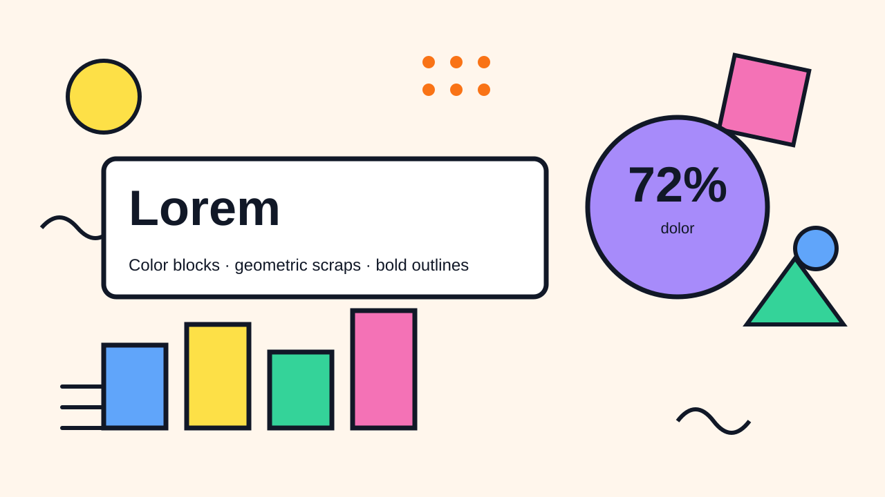
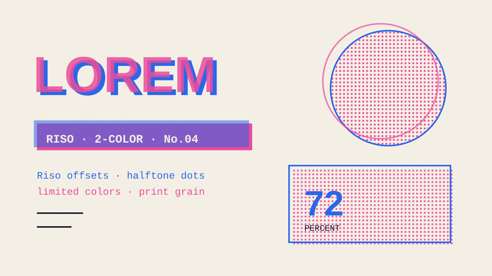
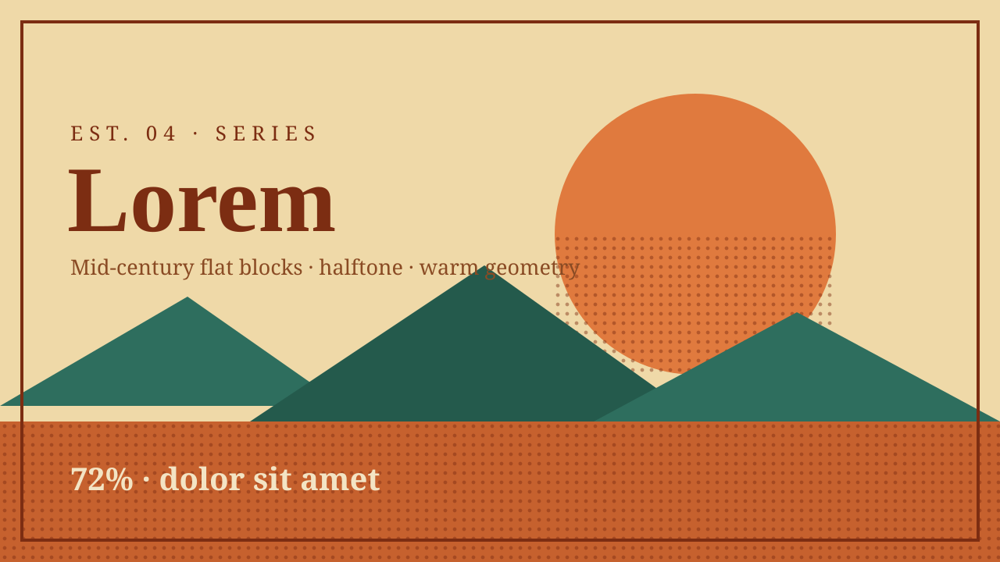
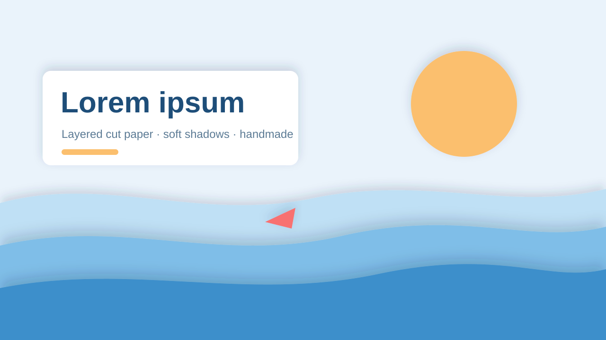

# PPT 视觉风格 · 表现力与印刷（4 种）

PPT 视觉风格里的表现力与印刷一组。视觉风格是什么、每条怎么读，看 [PPT 风格库](index.md#visual-styles)；怎么挑看[规划 deck](../../../skills/ppt-master/strategist.md#style)。每条不带色值，只管这套 deck 的配色怎么用；示意图是上游确认界面画的示意页，只示意版面气质。

### memphis · 孟菲斯 { #memphis }

冲撞的色块，几何碎纸屑，粗描边 ｜ 配套画风：[扁平插画](gallery-renderings-modern.md#flat) ｜ 插画分量：主导

孟菲斯、波普 —— 冲撞的色块、几何碎纸屑、粗描边、80 年代复兴的热闹。响亮又好玩。适合节庆、消费品牌、青年文化、发布造势，以及任何要能量不要克制的场合。

#### 形状与装饰

- 形状语言：大胆的几何基本形 —— 圆、三角、锯齿、波浪线、不规则色团 —— 带深色粗描边。允许混用不同圆角；好玩的不统一正是品牌味
- 构图手法：一个巨大的基本形从一边出血当背景；对角线一分为二的双色底；一条锯齿或波浪带当章节分隔；道具斜着散落在一个占主导、旋转着的框或徽章周围，徽章就在焦点上
- 装饰：散落的几何碎纸屑、色块衬底、图案填充（圆点、条纹）、超大的标点符号。装饰多 —— 但有构图，不乱
- 留白：充满能量的不对称；道具斜着漂浮。仍要给焦点内容留出在噪音里读得清的空间

#### 字体性格

- 标题用海报展示字（粗重、抓眼球）；正文用中性易读的无衬线体，让视觉能量之下的文字密度依然可读
- 标题字号大、自信，紧贴画面。正文靠对比保持干净安静

具体字体按主题挑，这种风格要的是海报展示标题配中性无衬线正文的性格。

#### 怎么用 deck 配色

- 多个强调色冲撞是招牌，但浅色底和深色描边在视觉上仍占主导。每页挑 deck 强调色里的一部分放到前台，而不是按配额把整套都摆出来
- 浅色底承载噪音；深色描边压住每个形状，让冲撞读起来是有构图的，而不是一锅浑汤。有纪律的热闹，绝不是彩虹乱炖

#### 质感与层次

- 以扁平的波普色块为主；靠粗描边分隔，不靠阴影。可选硬偏移阴影（贴纸、剪纸那种），做出复古波普感 —— 扁平的，不是柔和的。渐变少用

#### 插画分量

主导 —— 选了插画时，粗描边元素、碎纸屑和几何形状可以领衔孟菲斯语言。

### zine · 小刊 { #zine }

孔版印刷错版，半调网点，有限配色，印刷颗粒 ｜ 配套画风：[丝网印刷](gallery-renderings-narrative.md#screen-print) ｜ 插画分量：主导

孔版小刊、DIY 海报 —— 错位的色层、半调网点、严格受限的配色、手工印刷的颗粒感。独立出版的质感胜过精致。适合文化类 deck、设计分享、独立品牌，以及任何想要印出来、手工拼装感觉的场合。

#### 形状与装饰

- 形状语言：剪贴拼贴的色块、错位的色形、粗糙的框；描边用接近黑色的墨色。圆角很小或没有 —— 印刷的扁平，不是数字的柔软
- 构图手法：旋转着贴上去的色块（轻微歪斜）搭出拼贴舞台；一条撕纸带当章节分隔；一个超大的半调形状在内容后面出血；一个复印框或胶带贴角压住焦点块；宽窄混排的栏片
- 装饰：孔版印刷的痕迹 —— 微微可见的色层错位、半调网点 `<pattern>` 质感、重叠色块在交叠处暗示出另一种颜色。质感就是装饰
- 留白：海报式 —— 大胆的焦点色块，留粗糙的页边；刻意的粗糙胜过整齐对齐

#### 字体性格

- 朋克 DIY 的对比：标题用粗重的海报展示字，正文用朴素易读的无衬线体，注释用等宽字（打字机、复印机的感觉）
- 标题和安静的正文之间张力大；一点有意的松散，读起来像手工排的而不是机器排的

具体字体按主题挑，这种风格要的是海报展示字 × 朴素无衬线 × 等宽注释的性格。

#### 怎么用 deck 配色

- 严格受限的专色配色（孔版逻辑）铺在暖色纸底上；一对主墨色干大部分的活，其他专色挑着出现
- 颜色铺成扁平的专色，不用渐变；同一小组墨色的重叠和错位造出纵深和多出来的颜色。靠稀少和重叠，不靠种类多

#### 质感与层次

- 扁平的印刷，没有数字式浮起。纵深来自色层错位和半调颗粒，不靠阴影。用淡淡的质感或低不透明度半调做出暖纸纹理很对味；避免投影和光滑渐变

#### 插画分量

主导 —— 选了插画时，孔版和半调元素、剪贴图像可以领衔小刊的印刷颗粒感。

### vintage-poster · 复古海报 { #vintage-poster }

中世纪扁平色块，半调网点，复古几何的温暖 ｜ 配套画风：[复古海报](gallery-renderings-narrative.md#vintage-poster) ｜ 插画分量：主导

中世纪印刷海报（1950–1970 年代）—— 大胆的圆润几何形、有限的扁平色块、半调网点或纸纹、复古的温暖。适合文化类 deck、品牌故事、酒店餐饮、复古科技叙事、周年纪念、老字号品牌。

#### 形状与装饰

- 形状语言：边缘圆润、有机的大胆几何形，常常微微偏离轴线制造复古张力；重叠的扁平色块；带手绘感的粗线；风格化、简化的图形（一个风格化的太阳、一座棱角分明的山）
- 构图手法：一个巨大的太阳圆或拱形当背景锚点；从焦点放射出的光芒楔形；偏离轴线的重叠色块托起内容；一条地平线带把页面分成地面和天空两区；在强调点放一枚徽章或玫瑰花结印章
- 装饰：印刷痕迹 —— 半调网点叠层、轻微的套色错位 —— 撑起性格。生成的插画保持简化、图形化。必需的纪实照片照样能用；用裁切、减色、半调或别的印刷处理把它融进来，而不是用编造的图像替换真实主体
- 留白：自信的海报构图 —— 几块大色块，有意的负空间

#### 字体性格

- 标题用复古展示字（中世纪几何、自信）；正文简单易读，形成对比

具体字体按主题挑，这种风格要的是中世纪展示字的性格。

#### 怎么用 deck 配色

- 铺成有限的扁平色块（一小组颜色）：主色占大色块，辅色读作暖色纸底，强调色标出小形状或给半调网点上色
- 只用平涂 —— 不用渐变；纵深来自重叠，不靠混色

#### 质感与层次

- 扁平 —— 纵深靠形状重叠暗示，绝不靠阴影。低不透明度的半调网点或纸纹带来印刷的年代感；轻微的套色偏移很对味

#### 插画分量

主导 —— 选了插画时，中世纪图案和半调剪影可以领衔海报观感。

### paper-cut · 剪纸 { #paper-cut }

层叠的剪纸，层间柔和阴影，有触感 ｜ 配套画风：[剪纸拼贴](gallery-renderings-hand-drawn.md#paper-cut) ｜ 插画分量：主导

层叠的纸艺 —— 剪刀剪出的形状一层层叠起来，有触感，层与层重叠处带柔和阴影。温暖、手工，适合孩子又不幼稚。适合教育、儿童内容、文化和民俗题材、节庆、可持续发展。

#### 形状与装饰

- 形状语言：形状由利落、略不规则的剪边定义（不描边）；简化、风格化的形状，读起来像剪纸而不是插画。想让剪影读起来像手剪的，用不规则的 `<polygon>` / `<path>`，而不是一个完美的数字方框。功能性的形状和有意做成机器切割的纸层，在同一个纸艺体系里照样能用
- 构图手法：一层层波浪纸从下往上搭起页面；一个模切窗口露出下面那层；一个大的剪纸圆（太阳、月亮）压住构图；带标签的纸边给步骤排序；前景框一层，内容在后面那张纸上
- 装饰：层叠本身就是手法 —— 每个元素都是叠在下一张上的一张「纸」；顶层放小的剪纸点缀
- 留白：温馨、有构图 —— 衬底纸透出来就是呼吸空间

#### 字体性格

- 干净友好的无衬线体；温暖，不严厉。标题可以放在一条剪纸横幅形状上

具体字体按主题挑，这种风格要的是温暖、圆润、平易近人的无衬线性格。

#### 怎么用 deck 配色

- 每种颜色读作一张纸 —— 主色是最主要的前景纸，辅色是衬底，强调色是顶层的小剪纸
- 强调靠层叠和重叠，多过靠面积比例：哪怕一小张主色纸压在一大片辅色前面，读起来也是主色领衔

#### 质感与层次

- 真实的层叠纵深 —— 剪纸层下柔和、低不透明度的投影是这里的核心（唯一一种层叠阴影就是重点、而不是犯规的风格）。每张纸带哑光纸纹

#### 插画分量

主导 —— 选了插画时，层叠的剪纸元素可以领衔这种风格，透明切图天然贴合。
