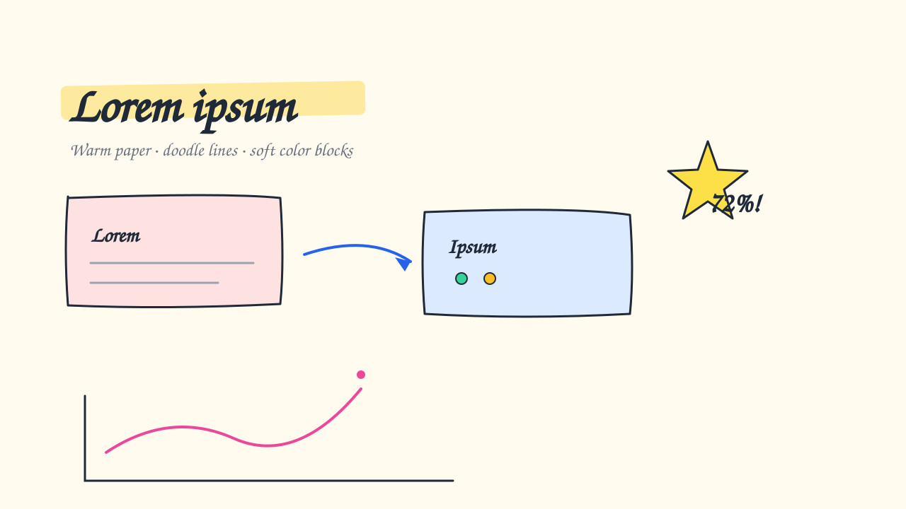
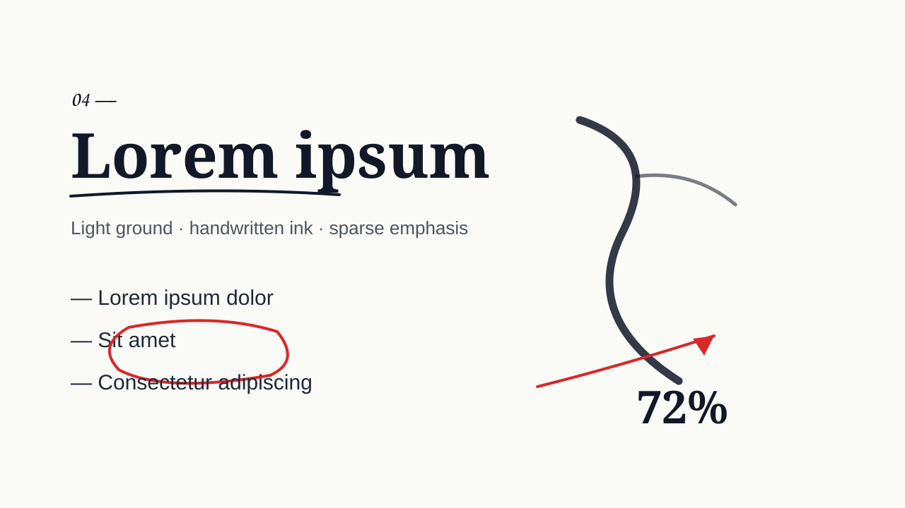
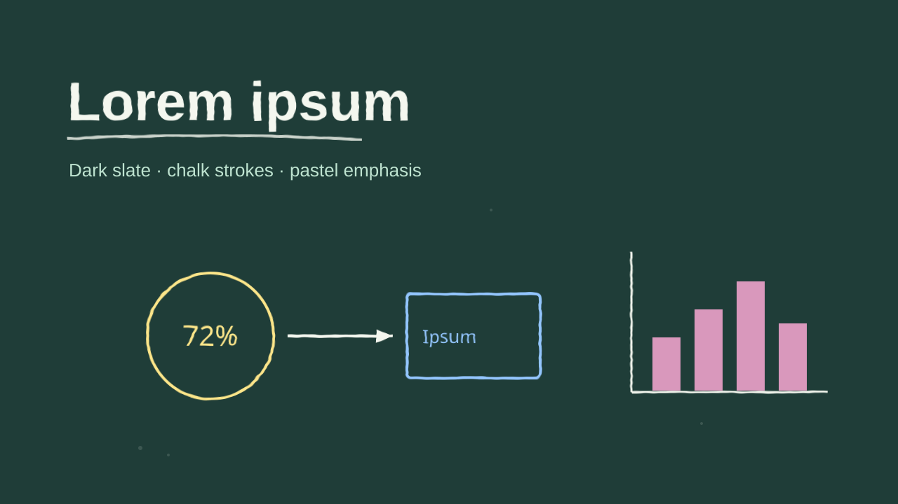
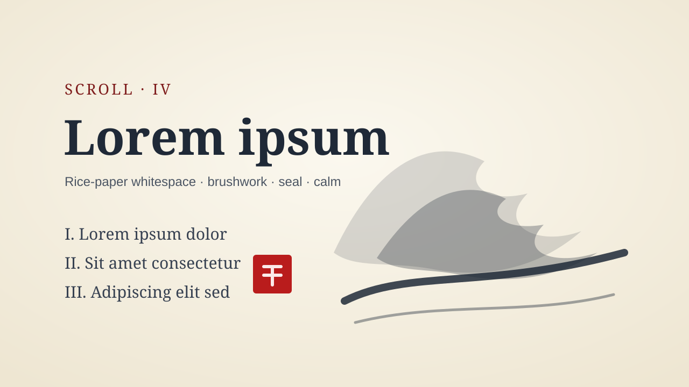

# PPT 视觉风格 · 手绘与笔墨（4 种）

PPT 视觉风格里的手绘与笔墨一组。视觉风格是什么、每条怎么读，看 [PPT 风格库](index.md#visual-styles)；怎么挑看[规划 deck](../../../skills/ppt-master/strategist.md#style)。每条不带色值，只管这套 deck 的配色怎么用；示意图是上游确认界面画的示意页，只示意版面气质。

### sketch-notes · 手绘笔记 { #sketch-notes }

暖色纸，涂鸦线稿，柔和的粉彩色块 ｜ 配套画风：[手绘笔记](gallery-renderings-hand-drawn.md#sketch-notes) ｜ 插画分量：主导

温暖的手绘笔记 —— 柔和的纸底、黑墨涂鸦线稿、温和的粉彩色块。最平易近人的一种风格，友好胜过精确。适合教育、培训、新人引导、科普、知识类内容。

#### 形状与装饰

- 形状语言：带一点抖动画出来的圆润形状；粉彩色块填充略微溢出描边（手涂感）；简单的卡通图标。轮廓要读起来像涂鸦时，用点位不对齐的 `<path>` 画出抖动，而不是把 `<rect rx>` 当手绘。功能性的形状照样能用，可以和手绘记号同页
- 构图手法：一条波浪箭头的旅程路线撑起整页；围着中心涂鸦的放射状思维导图；一条手绘横幅彩带托着标题；带编号的圆沿虚线路线跳着走；一个云朵框圈住要紧的那个想法
- 装饰：小涂鸦 —— 星星、闪光、圆点、下划线 —— 少量撒一点添温度；手绘波浪箭头连接想法，带简短的行内标签
- 留白：通透、有条理；元素之间留大间隙，保持友好，绝不密集

#### 字体性格

- 友好的手写标题；清楚的人文无衬线正文。温暖和可读胜过企业式的严厉

具体字体按主题挑，这种风格要的是温暖的手写体或人文体性格。

#### 怎么用 deck 配色

- 温暖柔和的纸底；deck 的颜色在色块里化作温和的粉彩浅色，而不是满饱和；留一个强调色给关键箭头或强调
- 大方但温和 —— 柔和的浅色，绝不高彩度，也不彩虹色

#### 质感与层次

- 扁平二维 —— 手绘笔记有意做成扁平。可选细微纸纹添温度；不加投影

#### 插画分量

主导 —— 选了插画时，涂鸦和手绘元素可以领衔这种风格，而不只是顺手的点缀。

### ink-notes · 墨迹笔记 { #ink-notes }

浅色底，黑色手绘墨线，稀疏的语义强调色 ｜ 配套画风：[墨迹笔记](gallery-renderings-hand-drawn.md#ink-notes) ｜ 插画分量：辅助

白板墨迹极简 —— 浅色底、自信的黑色手绘墨线、稀疏的语义色。深思熟虑、像宣言一样清楚，是手绘里专业的那一头。适合方法论、前后对比类文章、思维转变叙事、技术宣言。

#### 形状与装饰

- 形状语言：带轻微、有意抖动的手绘线稿 —— 方框、箭头、分隔线、括号，像在一块深思熟虑的白板上画出来的。记号要读起来像手绘墨迹时，用点位不在网格上的 `<path>` / `<polyline>` 画，而不是完美的基本形。功能性的形状照样能用；线条定义结构，一排排重复的填色卡片不是默认语法
- 构图手法：一个被圈起来的中心概念，分支箭头撑起整页；一个手绘的韦恩图或重叠示意图就是论证本身；划掉再替换的几何表达前后对比；一个超大的括号把证据归到论点下面
- 装饰：极少 —— 几个涂鸦记号（星星、短划、圆点、下划线）做强调。克制就是这种风格的长相；杂乱会破坏「深思熟虑」的感觉
- 留白：大方、空旷；浅色底占画布的大部分，元素周围留足空间漂浮着

#### 字体性格

- 标题用手写或人文性格 —— 粗、略大、自信。正文用朴素易读的无衬线体
- 读起来像手写的但是刻意的，不是企业式的精确

具体字体按主题挑，这种风格要的是人文或手写标题的性格。

#### 怎么用 deck 配色

- 接近单色：浅底上的墨色线稿撑起构图；deck 的强调色保持为稀疏的语义记号，标风险、正向状态或强调
- 颜色表意，不做装饰；只用在当前这一页有含义的强调色

#### 质感与层次

- 严格扁平 —— 没有阴影，没有纸纹（底子保持干净）。纵深只靠线宽和间距

#### 插画分量

辅助 —— 选了插画时，手绘墨迹元素可以给构图定锚、做标注或连接，这种风格深思熟虑的克制保持不变。

### chalkboard · 黑板 { #chalkboard }

深色石板，粉笔笔触，粉粉的粉彩强调 ｜ 配套画风：[粉笔黑板](gallery-renderings-hand-drawn.md#chalkboard) ｜ 插画分量：主导

教室黑板 —— 深色石板底、柔和的粉笔线稿、粉粉的粉彩强调。怀旧又有教学感。适合教学 deck、教程、校园和学术内容、复古教室氛围。

#### 形状与装饰

- 形状语言：粉笔笔触的线稿，边缘略微晕开、干涩；用粉笔画的方框、括号、箭头。记号要读起来像手绘粉笔时，用点位不对齐的 `<path>`，而不是完美的基本形。功能性的形状照样能用；它们的颜色、粗细和层级保持在黑板体系之内
- 构图手法：一个大粉笔圈圈住要紧的那个词；从中心概念放射开的思维导图；一条手绘弧形时间线扫过黑板；一个超大的粉笔括号把半页归成一组；一个装框的角落便签放结论
- 装饰：下划线和强调记号；撒几颗粉笔星星、圆点。黑板教学法 —— 分区有条理，中心焦点清楚
- 留白：深色黑板读作空间；让粉笔记号呼吸，而不是挤在一起

#### 字体性格

- 标题用手写粉笔性格；正文易读。干涩、怀旧、教室般温暖

具体字体按主题挑，这种风格要的是手写粉笔标题的性格。

#### 怎么用 deck 配色

- 深色石板底；米白粉笔承担大部分记号；deck 的颜色化作柔和、粉粉的粉彩粉笔强调，少量使用
- 克制、粉粉的 —— 绝不用饱和的填充

#### 质感与层次

- 扁平 —— 纵深来自粉笔笔触的粗细，不靠材质。满板的粉笔灰颗粒质感很对味；不加投影

#### 插画分量

主导 —— 选了插画时，粉笔画的记号和涂鸦可以领衔教室美学。

### ink-wash · 水墨 { #ink-wash }

宣纸留白，笔触，印章点睛，静 ｜ 配套画风：[墨迹笔记](gallery-renderings-hand-drawn.md#ink-notes)或[水彩](gallery-renderings-narrative.md#watercolor) ｜ 插画分量：辅助

新中式水墨 —— 宣纸底、文人式的大片留白、克制的笔触、一枚印章点睛。静、考究、东方。适合文化读书分享、哲学、非遗传承、修身、新中式叙事。

#### 形状与装饰

- 形状语言：极简的笔触记号和细分隔线；偶尔一块墨色色块；一枚方形印章当焦点点睛。避免一排排重复的卡片、方框网格，让空本身成为结构。想表现笔触或墨晕的记号，用控制点不均匀的不规则 `<path>`，而不是拿 `<ellipse>` / `<circle>` 冒充晕染。功能性的形状在表意又不把页面变成框框界面时照样能用
- 构图手法：一道宽阔的笔刷扫过，当页面的斜向脊梁；一个开口的圆相式圆环框住核心语句；一条竖向卷轴带给一串内容排序；一条低低的水墨地平线，内容漂在上方的空白里；印章摆在能给非对称画面压秤的位置
- 装饰：几乎没有；有的那一点读起来是笔和印。非对称、卷轴式的构图，有意不平衡
- 留白：大片、有意 —— 宣纸底占页面的大部分；几个元素漂在一片大静之中

#### 字体性格

- 标题用毛笔或衬线性格（书法感、有表现力），正文用干净的现代无衬线体 —— 楷体 × 黑体的对比轴。标题大而通透，行距宽松，欢迎竖排节奏

具体字体按主题挑，这种风格要的是书法毛笔标题配干净无衬线正文的性格。

#### 怎么用 deck 配色

- 浅色宣纸底占主导；墨色承担文字和偶尔的墨色形状；一个暖调的印章红强调色只出现在一个关键点 —— 稀少，像卷轴上的一枚印
- 接近单色的墨色纪律 —— 克制就是美感，不靠丰富

#### 质感与层次

- 扁平 —— 空白和笔触的轻重承担纵深，不靠阴影。可选淡淡的纸纹或低不透明度的墨晕；不加投影

#### 插画分量

辅助 —— 选了插画时，笔墨、印章或绘画元素可以给页面定锚或取景，静和留白保持主导。
