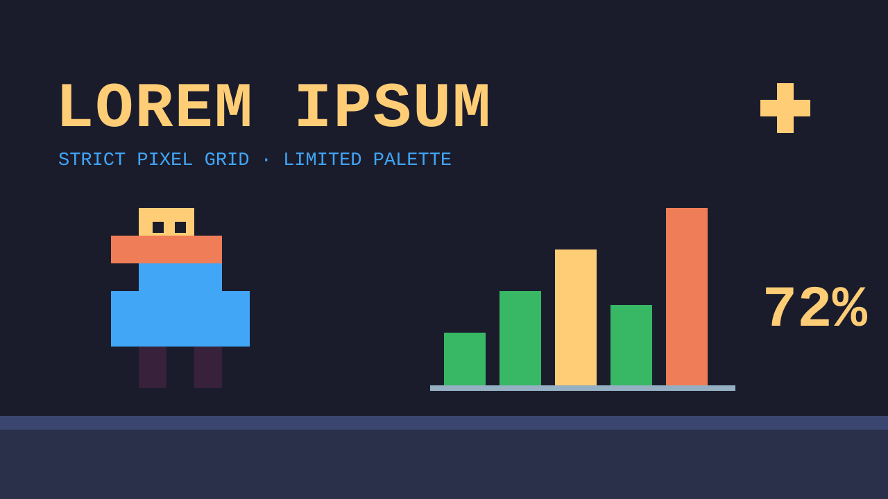

# PPT 视觉风格 · 特殊题材（1 种）

PPT 视觉风格里的特殊题材一组。视觉风格是什么、每条怎么读，看 [PPT 风格库](index.md#visual-styles)；怎么挑看[规划 deck](../../../skills/ppt-master/strategist.md#style)。每条不带色值，只管这套 deck 的配色怎么用；示意图是上游确认界面画的示意页，只示意版面气质。

### pixel-art · 像素风 { #pixel-art }

严格的像素网格，方块形状，有限配色，扁平 ｜ 配套画风：[像素艺术](gallery-renderings-specialty.md#pixel-art) ｜ 插画分量：主导

8 位复古游戏 —— 严格的像素网格、敦实的方块形状、有限的配色、不做抗锯齿。好玩又怀旧。适合游戏类 deck、复古科技 deck、怀旧或带游戏味的教育和娱乐内容。

#### 形状与装饰

- 形状语言：决定风格的可见形状都对齐像素网格 —— 方块形状、阶梯边缘、生硬的过渡、没有平滑曲线；可选 1 像素深色描边增加清晰度。PowerPoint 自带的预设形状在方块化处理后语义轮廓还在的话照样能用；否则用忠实的阶梯形拼出来
- 构图手法：一道阶梯状像素台阶当分隔；一个超大的精灵图压住页面；带角括号的 HUD 框划分内容区域；沿底边一条地砖地面带；一条像素进度条当顺序手法
- 装饰：经典游戏的框法 —— HUD 条、地砖地面、精灵图标、粗像素边框。参照 NES、SNES、街机的构图
- 留白：守网格纪律；让方块落在干净的地砖地面上，而不是挤在一起

#### 字体性格

- 标题用像素或点阵展示字的性格；正文保持干净易读的字体 —— 满屏像素字的正文读长了很累

具体字体按主题挑，这种风格要的是像素或点阵展示字的标题性格，正文另配易读的字。

#### 怎么用 deck 配色

- 颜色当调色板槽位用：主色是主要物体，辅色是地形或背景，强调色是高光和标记；主色的深一档当描边像素
- 只用平涂色块 —— 明暗来自调色板分层（上亮下暗），绝不用渐变

#### 质感与层次

- 除了像素网格本身，没有别的质感；严格扁平的色块。纵深来自上亮下暗的像素明暗，不靠投影

#### 插画分量

主导 —— 选了插画时，像素精灵和方块形状可以领衔这种风格。
