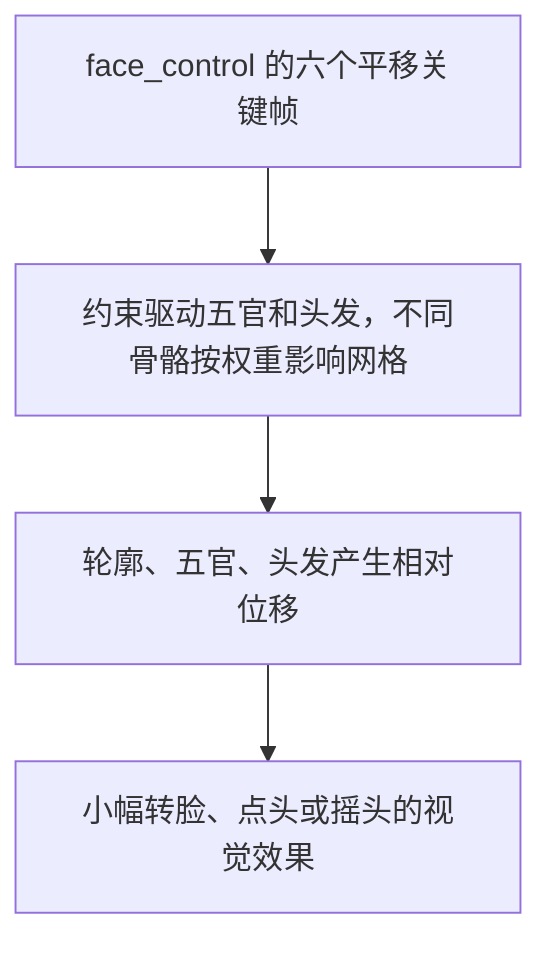

# 二维角色动画（2D character animation）：给角色素材、动作和时间，算出此刻的画面

**二维角色动画的通用功能只有一件事：给一套角色素材、一个动作指令和当前时间，算出此刻该显示的画面。** 细分方向都是被新需求逼出来的：几个动作要同时在身上、切换不能跳，就要分层与混合；要跟着声音动嘴，就要嘴型驱动；正面立绘要略微转脸，就要约束和加权网格。术语按 Spine 和 Live2D 官方文档的叫法 —— 骨骼、网格、权重、变形器、动画混合；口型另用语音工具的 viseme、lip sync。[^mesh][^live2d][^mix] 在[领域地图](../index.md#transformation)上它在「内容变换」一组，处理对象是已有的二维角色素材；素材从哪来、怎么拆、怎么绑，归[二维角色生成](../2d-character-generation/index.md)。

四条路线各配一个交互演示：Alice 看 Spine，大肥鱼看 Live2D，鹈鹕看矢量程序化，序列帧的例子在 Gallery；三个方向都用樱木真乃演示。视角要自由转、要实时光影，去[三维角色动画](../3d-character-animation/index.md)。

## 通用功能：素材加时间，得到一帧 { #basic }

- **输入**：做好的角色素材 —— 帧图、Spine 图集和骨骼、Live2D 模型或 SVG，怎么做见[二维角色生成](../2d-character-generation/index.md)；可用的动作或参数；当前时间。互动角色再加控制状态：情绪、是否在说话、是否点头
- **输出**：连续的二维画面，直接画在网页 Canvas 或 SVG 里，或离线导出成视频、图像序列
- **顺手处理的**：播放速度、循环、整体缩放、镜像、取景，以及素材支持的局部动画组合
- **典型用途**：游戏角色、对话立绘、虚拟宠物、直播形象、网页吉祥物
- **管不了的**：从正面图恢复背面、凭空长出没画过的部件、决定角色该说什么；运行库也不会自动把声音变成正确的嘴型

## 四条路线：逐帧、骨骼、参数变形、矢量程序化 { #routes }

**四条路线的差别在「每帧算什么」：什么都不算只选图，算骨骼再拉网格，按参数插形态，还是直接重写形状。**

| 路线 | 思想 | 成本落在哪 | 适合 |
|---|---|---|---|
| 序列帧（sprite animation） | 每一帧都画好，运行时按时间选帧 | 每帧都要画；动作一多画面成倍增加 | 固定的短动作、特效、手绘形变多的动画 |
| Spine 骨骼动画（skeletal animation） | 在部件上打关键点，只记关键点怎么走，图跟着拉伸 | 拆图、绑定、刷权重；多个动作共用一套部件 | 身体动作多，要分层叠加、换附件 |
| Live2D 参数变形（parameter-driven deformation） | 每个参数存几个关键形态，运行时按参数值插值 | 拆图补画、建网格、调每个参数的关键形 | 以一张正面立绘为中心，连续调脸部角度、眼睛、嘴型 |
| 矢量程序化（SVG） | 形状本身是代码，每帧改变换或重写路径 | 每个形状和动作都写成公式，靠看图调参 | 没有美术、要 AI 直接写出来、要任意分辨率 |

=== "序列帧"

    **每一帧都画好，运行时只选帧。** 不拆结构、不算形变，最省运行时；代价是每个动作、每个方向都要画一遍。本站的例子在 Gallery 的 [3D 像素幸存者](../../../gallery/games/terrace-survivors.md#faq-sprites)：每个角色是一张 8 个方向乘 5 个动作的图集，画在一块始终朝向镜头的面片上。

    ??? note "GIF 为什么远小于 N 张 PNG 的总和"

        **GIF 的文件大小不等于逐帧 PNG 相加。** PNG 自己有压缩；GIF 再用调色板索引、LZW 编码，并允许每幅图像指定位置和尺寸 —— 优化器结合透明索引和帧处置方式，只更新变化的矩形。只眨眼的角色，后续图像块可以很小；全屏都在变时收益有限。代价是每块最多 256 色，没有 RGBA 那样的连续透明度。[^gif] 这是编码器利用帧间冗余，不是 GIF 理解了眼睛或骨骼，也不是视频编码那种运动预测。

        | 指标 | 衡量什么 | 不能由什么直接推出 |
        |---|---|---|
        | 文件大小 | 保存和传输的字节数 | 解码后的纹理内存 |
        | 内存占用 | 解码画面、图集、缓存、骨骼数据 | PNG 或 GIF 压缩后的体积 |
        | 运行开销 | 解码、合成、骨骼、网格、实际绘制 | 「Spine 一定比序列帧省计算」—— 大量复杂网格角色同时跑时骨骼和网格更重，简单序列帧的播放逻辑可以很轻 |

=== "Spine 骨骼动画"

    **在部件上打关键点，只记关键点怎么走。** 骨骼是一串有父子关系的点，动画只记每根骨骼在几个时刻的位置和角度，中间由运行库插值；部件图整块挂在骨骼上，或切成网格、顶点按权重跟着几根骨骼拉伸。动作再多，图集也只有一份。

    Alice 来自本地的 `663日韩二.zip`（实际是 RAR），原作者未核实，演示只收其中一套角色；Spine 3.6.52，93 根骨骼、10 个完整动作、一张 512 × 512 图集。

    <iframe src="/posts/domains/2d-character-animation/assets/alice.html"
            style="width:100%;height:820px;border:1px solid #8884;border-radius:10px"
            loading="lazy" title="Alice：Spine 动作播放演示"></iframe>

    [单独打开 Alice 演示](assets/alice.html){ target="_blank" rel="noopener" }

    先选 `idle`、`run`、`atk1`，看身体部件和海豚在不同动作里怎么动；暂停后拖进度，勾「显示骨骼」看绑定。待机、奔跑、攻击共用[图集](assets/alice/data.atlas)、[贴图](assets/alice/Alice_130008_Q.png)和[骨骼数据](assets/alice/data.json)。`atk3_weapon` 是武器特效，列表里不是每一项都是完整的身体动作。

    ??? note "二进制 `.skel` 怎么变成网页能读的 JSON"

        旧版网页运行库只读 JSON，[转换脚本](assets/convert-spine36.py)把[原始二进制](assets/alice/original.skel)转成[预览 JSON](assets/alice/data.json)。原文件头部声明 11 个动画，读完 10 个完整动画恰好到文件末尾 —— 脚本只在「正好停在动作边界」时停止，不补造第 11 个，也判断不出缺的叫什么；其他读取错误照样报错。

=== "Live2D 参数变形"

    **不记动作画面，记参数。** 每个参数在几个取值上各存一个网格形态，叫关键形；运行时按参数值在关键形之间插值，几个参数的效果叠加。动作就是参数随时间的曲线。大肥鱼是 JackCui 公开的 Live2D 模型，32 个参数、35 个绘制部件、11 个动作、4 个表情，本站用官方 Cubism Core 实时播放；它怎么从立绘做出来，见二维角色生成的[绑定](../2d-character-generation/index.md#rigging)。[^dafeiyu]

    <iframe src="/posts/domains/2d-character-animation/assets/dafeiyu.html"
            style="width:100%;height:920px;border:1px solid #8884;border-radius:10px"
            loading="lazy" title="大肥鱼 Live2D：动作、表情、参数与网格演示"></iframe>

    [单独打开 Live2D 演示](assets/dafeiyu.html){ target="_blank" rel="noopener" }

    先选「挥手」「动耳朵」或「摆尾巴」，暂停后拖进度；再拖眼睛、嘴巴、转头的滑杆，勾「显示三角网格」—— 一个参数拉动的是一片网格的顶点，不是换一张图。调参数会暂停动作，「复位」回到待机。

=== "矢量程序化"

    **形状本身是代码，每帧直接改形状。** 部件是 SVG 路径，关节是 `<g>` 的变换；动画是每帧改变换，或者整条重写路径。没有像素，放多大都不糊。鹈鹕是一句话 prompt 让 AI 写出来的，演示和源码收在 Gallery 的[鹈鹕骑自行车](../../../gallery/animation/pelican-bicycle.md)：

    <iframe src="/gallery/animation/assets/pelican-bicycle.html"
            style="width:100%;height:640px;border:1px solid #8884;border-radius:10px"
            loading="lazy" title="鹈鹕骑自行车：纯 SVG 绘制、脚本驱动的二维动画"></iframe>

    全身只有一个时钟：车轮累计转角。公路位移、曲柄角、踏板位置都从它推出来，腿再用两段骨骼 IK 反解膝盖：

    ```js title="pelican-bicycle.html:567-587"
    --8<-- "gallery/animation/assets/pelican-bicycle.html:567:587"
    ```

    ```js title="pelican-bicycle.html:509-517"
    --8<-- "gallery/animation/assets/pelican-bicycle.html:509:517"
    ```

    和三维角色动画里[羊的腿](../3d-character-animation/index.md#locomotion)是同一个解法，只是少了一维。

!!! note "两条绑定路线的能力有重叠"

    别按「Spine 只会动身体、Live2D 才会转脸」分界。Live2D 文档说的是变形器用来成组编辑顶点：

    > "Use deformers to edit vertices together"[^live2d]

    Spine 同样有网格和权重，[真乃的扭头](#turn)就是用它做的。选型要看已有素材是哪种、团队熟哪套工具、目标平台有没有运行库，不能只看播放器截图。

## 细分方向：一个新需求，一个方向 { #needs }

### 要几个动作同时在身上、切换时不跳：分层与混合（layering、mixing） { #transition }

**身体、表情、嘴巴各占一条轨道叠加；切换靠混合，或者靠专门的衔接动作。** Spine 的 AnimationState 把两件事分别叫 "mixing (crossfading)" 和 "layering"。[^mix] 真乃来自[已收录的 Eidolon-SC 项目](../../../projects/eidolon-sc/index.md)：立绘和动画是原作游戏素材，Eidolon-SC 提供同步与控制逻辑；本站按它的衣装配置和下载路径取得默认私服「ナチュラルモード」，编号 `stand/1030010010`，Spine 3.6.53，72 根骨骼、62 个动画资源。[^eidolon]

<iframe src="/posts/domains/2d-character-animation/assets/mano.html"
        style="width:100%;height:1000px;border:1px solid #8884;border-radius:10px"
        loading="lazy" title="樱木真乃：身体、表情、嘴型和摇头的分层演示"></iframe>

[单独打开真乃演示](assets/mano.html){ target="_blank" rel="noopener" }

选一个身体动作，再选「叠加表情」、勾「模拟说话」，最后点「点头」或「摇头」—— 这些变化同时存在。62 是动画资源总数，含表情、嘴型、视线和辅助动作，不是 62 段完整身体动作；下拉菜单把身体、表情、嘴型分开了。

**叠加**：按轨道叠，每条轨道一类动画。

| 轨道 | 原项目用途 | 本页演示 |
|---|---|---|
| 0 | 身体动作 | 动作下拉菜单 |
| 1 | 表情 | 叠加表情 |
| 2 | 点头、摇头 | 播一次后退出 |
| 3 | 视线 | 没有独立控件 |
| 5 | 嘴型 | 循环张合，或冻结在闭嘴姿势 |

「放在高轨道」不等于自动隔离部件：一条动画记录了哪些骨骼、附件或网格，就会影响那些对象，能不能自然组合取决于素材制作时的分工。原项目按情绪选身体、脸和嘴型，动画名不齐全的衣装用候选回退。[^eidolon]

**切换**：三种做法，按两段姿势差多远选。

| 做法 | 发生什么 | 适用 |
|---|---|---|
| 直接切换 | 结束旧动作，立即应用新动作 | 要立即反馈，或两段姿势本来就接近 |
| 动画混合 | 短时间内降低旧动画的影响、提高新动画的影响 | 待机、说话、情绪这类普通切换 |
| 专门衔接动作 | 先播一个收手、转身或复位动作，再进目标动作 | 单纯插值会让手穿过身体，或动作有必须完成的阶段 |

Eidolon-SC 普通混合 0.3 秒，嘴型 0.1 秒；身体动作里的 `relay` 事件指定离开前的收手动作，`loop_start` 指定首次播放后该循环的尾段 —— 「举手说话 → 收手 → 待机」既有姿势混合，也有动作顺序。[^eidolon] 矢量程序化没有「两段动画」可混：鹈鹕变速时，实际速度每帧往滑杆的目标值逼近，平滑做在参数上。

!!! warning "本页播放器不演示完整的衔接状态机"

    为了看清单个动作，切换身体动作时先 `clearTracks()`、`setToSetupPose()` 再播目标动作；表情和嘴型在各自轨道内仍有混合。默认混合时间不会给已经清空的旧身体动作生成过渡。

### 要跟着声音动嘴：嘴型驱动（lip sync、viseme） { #mouth }

**「说话时动嘴」和「按发音对嘴型」是两个精度的目标。** 真乃演示里的「模拟说话」没有音频输入，只循环素材已有的 `lip_*` 动画，取消勾选就把同一嘴型冻结在第 0 帧。Eidolon-SC 也是状态驱动：开始说话就循环当前情绪的嘴型，停止或被打断就闭嘴；没用音量，也没逐音素识别。它的发音词典是让 TTS 念对名字的，不输出嘴型时间轴。[^eidolon]

| 方案 | 输入和控制方式 | 适合什么、限制在哪 |
|---|---|---|
| 说话状态驱动 | 开始播放就循环，结束就闭嘴 | 接入最简单；张合节奏和实际发音无关 |
| 音量驱动 | 从实际播放的音频取短时能量，映射开合程度并平滑 | 跟得上停顿和力度；分不出「啊」和「呜」 |
| TTS 带嘴型时间轴 | 合成语音时同时返回视素编号和时间戳，映射到角色嘴型 | 贴发音；依赖声音、语言和服务的支持 |
| 分析已有音频 | 对录音生成嘴型时间轴，再同步播放 | 预录对白合适；流式对话要另处理分段和延迟 |

- Azure Speech 返回的 "Audio offset" 是嘴型相对音频的时间位置；viseme 是一组外观相近的发音对应的可见口型，和音素不一一对应。支持情况要按语言、声音、输出类型确认[^viseme]
- Rhubarb Lip Sync 对录音输出 "which mouth shape to display at what time"，有 Spine 集成；默认识别器面向英语，其他语言用 `phonetic` 模式、官方说精度通常较低。它不是插进网页就能用的实时音频流组件[^rhubarb]
- 工具解决的是「何时用哪种嘴型」，接入者还要定义「这个编号对应本角色的哪个附件或参数」。真乃素材有多种情绪嘴型，但没有标注标准 viseme 映射；要做精细发音得先查现有形态够不够，再决定映射或补画
- 矢量路线里嘴型就是几条路径：鹈鹕的喉囊每帧重写一次路径，换成按视素挑目标路径、在两条之间插值，就是对嘴型
- 所有时间轴对齐实际音频的播放进度，不对齐文本或网络数据到达的时间

### 要让正面角色略微转脸：约束与加权网格（constraints、weighted mesh） { #turn }

**小幅扭头不用把平面图沿三维轴旋转，现有素材就能做。** 真乃的 `no`（摇头）动画，骨骼时间轴只给 `face_control` 写了六个平移关键帧，没有旋转轨道；转脸效果全靠绑定：

1. 脸是 34 个顶点的加权网格，不同顶点受 `face_`、`head`、`face_control`、`Face_re` 等骨骼共同影响，移动控制器就改变脸部轮廓
2. 眼睛、嘴巴、部分前发通过 transform constraint 跟随 `face_control`，平移混合系数分别是 0.20、0.19、0.10 —— 不是整张脸等量平移，所以有相对运动
3. `Face_re` 的平移混合系数是 −1，反向运动；它同时影响脸部、眼睛和头发网格，给转脸提供不同方向的形变



这些数字是这个模型的绑定参数，不是通用转头公式；控制器坐标是骨骼局部坐标，JSON 里的 x、y 不能直接当屏幕的左右和上下。Spine 网格文档写 "Meshes can be deformed automatically"[^mesh] —— 动画时间轴不必逐帧记录所有顶点，网格会随带权重的骨骼变化。演示里点「摇头」就是 `no`，不用切身体动作。

??? abstract "扭头证据：六个关键帧、四条约束与脸部顶点统计"

    从原始 JSON 提取，不是手写示意；`bone_vertex_counts` 统计一个骨骼影响了多少顶点，不是权重百分比，同一顶点可重复计入不同骨骼。对照[原始数据](assets/mano/data.json)，用[提取器](assets/inspect-rig.py)能重新生成[证据文件](assets/turn-evidence.json)。

    ```json
    --8<-- "posts/domains/2d-character-animation/assets/turn-evidence.json"
    ```

    ```python
    --8<-- "posts/domains/2d-character-animation/assets/inspect-rig.py"
    ```

## 怎么选 { #choose }

**先看素材里有没有目标形态，再选控制方法。** 从现有正面角色做小幅转脸，Spine 够用；转到明显侧面、背面，或露出没画过的手臂内侧，才需要补画、切换附件或重新绑定 —— 问题在素材有没有目标形态，不是「二维角色不能扭头」。待机显得机械，就备几套眨眼、视线和微动作，按状态随机挑、设间隔、避免连续重复，这是常规调度，不是哪条路线的技术障碍。

| 需求 | 优先考虑 |
|---|---|
| 几个固定短动作，手绘形变多 | 序列帧，制作和接入最直接 |
| 身体动作多，要叠表情、换附件 | Spine，前提是素材和绑定支持 |
| 以正面立绘为中心，连续调脸部参数 | Live2D；同时查现有 Spine 素材是不是已经够用 |
| 没有美术、要 AI 直接写出来、要任意分辨率或运行时换色 | 矢量程序化 |
| 大角度自由视角、姿态和光照 | [三维角色动画](../3d-character-animation/index.md#choose)，或给二维方案补视角素材 |
| 一张肖像加语音直接出说话画面 | 生成式说话视频或实时头像引擎，见相邻任务 |

!!! warning "接入成本在版本、边缘和授权"

    - 运行时版本要和导出版本匹配：本页两个 Spine 例子用同一份官方 3.6 WebGL 运行库读 3.6.52 和 3.6.53 的数据，这一组合验证过，推不出其他版本都能互换
    - 透明边缘、图层顺序、设备性能和资源释放，每接一个平台都要再过一遍
    - 角色素材和运行库各有自己的权利来源：项目代码开源不等于角色素材开放使用；Spine 运行库的许可见[三维那页的对照](../3d-character-animation/index.md#vs-2d)

## 相邻任务：常一起出现，但不属于这个领域 { #neighbors }

- **二维角色生成**：素材从哪来、怎么拆层、怎么绑定，属内容生成，见[二维角色生成](../2d-character-generation/index.md)
- **实时生成式说话头像**：从语音逐帧生成嘴部或头部画面，属内容生成，见 [Mynah](../../../projects/mynah/index.md)；本页的演示只驱动预制素材，不生成新图
- **AI 伙伴与角色对话**：决定角色说什么、记得什么、何时回应，见 [Eidolon-SC](../../../projects/eidolon-sc/index.md)；它把情绪和说话状态交给动画控制层
- **三维角色动画**：有空间几何、相机、材质和绑定，视角自由，见[三维角色动画](../3d-character-animation/index.md)；那张把 Spine 的骨骼、网格权重、IK 约束和三维的对应概念列成了表
- **放进三维场景**：序列帧画在始终朝向镜头的面片上，按观察角度取对应方向那一行，叫 billboard 精灵、8 方向精灵；像素角色配 3D 场景的风格常叫 HD-2D，见 Gallery 的 [3D 像素幸存者](../../../gallery/games/terrace-survivors.md#faq-sprites)
- **视频合成**：把已生成或已渲染的角色放进其他画面，见[视频合成](../video-compositing/index.md)

## 演示源码与来源 { #sources }

- **Spine 播放器**：Alice 和真乃共用[播放逻辑](assets/player.js)和[样式](assets/player.css)，各自的入口页只带一段配置；运行库也在本站，不访问上游 CDN。iframe 离开视口或标签页隐藏时停绘，回来不覆盖手动暂停；暂停时改进度、表情、取景只重绘一帧
- **Live2D 播放器**：模型、贴图和[运行库](../../../vendor/live2d/SOURCE.json)都本站托管；参数直接送入 Cubism Core，动作读作者的 `motion3.json`。停绘规则同上。[验证脚本](assets/check-live2d.cjs)用实际 Core 检查了 671 个动作姿势、64 个参数端点和 4 个表情，没做浏览器图像验收
- **鹈鹕**：完整源码折叠在 Gallery 的[鹈鹕骑自行车](../../../gallery/animation/pelican-bicycle.md#source)
- **来源与校验**：[素材来源与 SHA-256](assets/sources.json)记录 Alice、真乃和二维角色生成那页橘猫的来源与转换；Spine 运行库的[来源记录](../../../vendor/spine-3.6/SOURCE.txt)和[许可证](../../../vendor/spine-3.6/LICENSE)随文件保留

??? abstract "Alice 演示入口源码"

    ```html
    --8<-- "posts/domains/2d-character-animation/assets/alice.html"
    ```

??? abstract "真乃演示入口源码"

    ```html
    --8<-- "posts/domains/2d-character-animation/assets/mano.html"
    ```

??? abstract "Live2D 演示入口与播放逻辑"

    ```html
    --8<-- "posts/domains/2d-character-animation/assets/dafeiyu.html"
    ```

    ```javascript
    --8<-- "posts/domains/2d-character-animation/assets/live2d-player.js"
    ```

    ```javascript
    --8<-- "posts/domains/2d-character-animation/assets/live2d-motion.js"
    ```

??? abstract "一手文档短句摘录、出处与读取日期"

    ```text
    --8<-- "posts/domains/2d-character-animation/assets/sources-excerpts.txt"
    ```

[^mesh]: Esoteric Software，[Mesh attachments](https://esotericsoftware.com/spine-meshes)，读取于 2026-11-05；网格、权重与形变的官方说明，短句摘录见文末。
[^live2d]: Live2D，[About Deformers](https://docs.live2d.com/en/cubism-editor-manual/deformer/)，读取于 2026-11-05；演示已接入官方 Cubism Core，运行库版本和来源见本页记录。
[^gif]: CompuServe，[GIF89a 规范](https://www.w3.org/Graphics/GIF/spec-gif89a.txt)，读取于 2026-11-05；参见 Image Descriptor、Graphic Control Extension 与 Appendix F。PNG 的压缩机制见 [PNG compression](https://www.w3.org/TR/png-3/#10Compression)，读取于同日。
[^mix]: Esoteric Software，[Applying Animations](https://esotericsoftware.com/spine-applying-animations)，读取于 2026-11-05；术语参考该文，当前旧版 API 以随站保留的 3.6 runtime 为准。
[^eidolon]: Sallyn0225/eidolon-sc，2026-11-04 获取，固定于 commit `596368d7f7253d58840eb4f0e6f02f57c4418552`：[衣装配置](https://github.com/Sallyn0225/eidolon-sc/blob/596368d7f7253d58840eb4f0e6f02f57c4418552/characters/characters.toml)、[素材下载](https://github.com/Sallyn0225/eidolon-sc/blob/596368d7f7253d58840eb4f0e6f02f57c4418552/backend/src/eidolon/stand_fetch.py)、[动作与嘴型控制](https://github.com/Sallyn0225/eidolon-sc/blob/596368d7f7253d58840eb4f0e6f02f57c4418552/frontend/src/components/conversations/stand/StandEngine.ts)、[说话状态选择](https://github.com/Sallyn0225/eidolon-sc/blob/596368d7f7253d58840eb4f0e6f02f57c4418552/frontend/src/lib/standAnimations.ts)。原始素材取自 ShinyColorsDB CDN 的 `spine/idols/stand/1030010010/`，URL 与校验值见本站来源文件；原作游戏素材不随项目代码许可证开放。
[^viseme]: Microsoft，[Get facial position with viseme](https://learn.microsoft.com/en-us/azure/ai-services/speech-service/how-to-speech-synthesis-viseme)，读取于 2026-11-05。
[^rhubarb]: DanielSWolf，[Rhubarb Lip Sync](https://github.com/DanielSWolf/rhubarb-lip-sync)，读取于 2026-11-05；参见 Output formats、Recognizers 和 Spine 集成说明。
[^dafeiyu]: Jack-Cherish/dsi，固定于 commit `84f518088c2fc727af628d65ffe85ec01a91254e`：[模型包](https://github.com/Jack-Cherish/dsi/blob/84f518088c2fc727af628d65ffe85ec01a91254e/dafeiyu/assets/character.airi.zip)、[PSD 与 Cubism 工程](https://github.com/Jack-Cherish/dsi/tree/84f518088c2fc727af628d65ffe85ec01a91254e/dafeiyu/assets/source)、[作者校验清单](https://github.com/Jack-Cherish/dsi/blob/84f518088c2fc727af628d65ffe85ec01a91254e/dafeiyu/SHA256SUMS)，读取于 2026-11-05；只提取模型制作产物。
