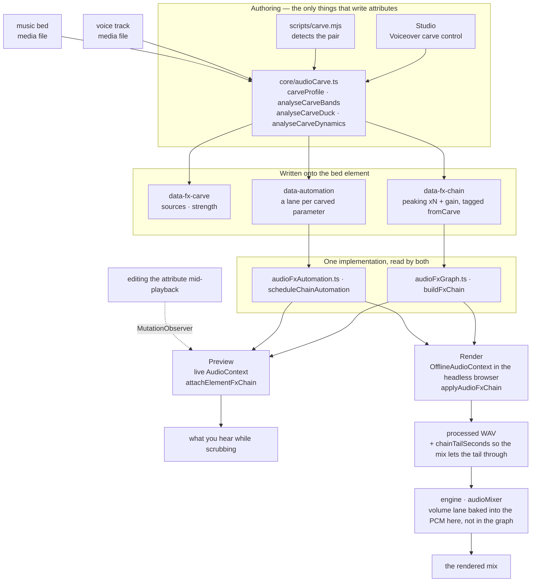
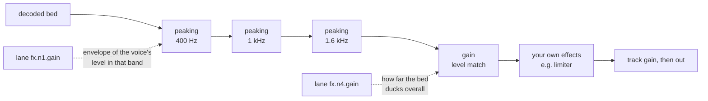

<!-- 中译自 heygen-com/hyperframes@46f6cb3 的 skills/hyperframes-audio/SKILL.md（Apache-2.0）；改动说明见 skills/hyperframes/MIRROR.md -->

**插件安装：** 当本 skill 位于 HyperFrames 插件内时，在执行安装或更新类命令之前，先遵守[插件执行规则](../hyperframes/references/plugin-installation.md)。独立安装的情况沿用下面的更新说明。

# HyperFrames 音频

混音是一组关系，而不是一摞处理器。两条各自单独听都没问题的 track，放在一起可能难以入耳，而解决办法几乎从来不是"把其中一条调小"——而是找出它们在争抢什么，再把它交给真正需要它的那一条。这里的每一个工具都是为了表达其中某一种关系而存在的。

效果以 `data-fx-chain` 的形式挂在元素上，预览和渲染跑的是同一张 Web Audio 图——Studio 在实时上下文里跑，引擎在它本来就在驱动的浏览器里、用离线上下文跑。每种效果只有一份实现，所以你来回拖动时听到的，就是最终写出来的。你永远不用调两遍。

Clip 时间仍然归 `/hyperframes-core`：音频/视频的裁剪和源区间用 `data-start`、`data-duration` 和 `data-media-start`，交叉淡化则是把 clip 放在不同 track 上重叠。本 skill 负责已放置 track 的淡入/淡出、交叉淡化包络、track 增益/track 音量、音量与效果自动化、闪避/旁白挖空，以及效果链。`/media-use` 负责获取、生成和预处理。

当对应的音频/视频元素使用相同的时间、源偏移和速率时，恒定的 `data-playback-rate`（`0.1..10`）对画面和保持音高的声音都是渲染安全的。变速坡道是 `data-automation` 里的一条 `rate` lane（见 `docs/reference/speed-ramps`）；它优先于恒定值，并且在预览和渲染中都保持音高。HyperFrames 不提供自动的波形同步或漂移校正。可直接复制的剪切/交叉淡化/重定时配方，用 `/hyperframes-core` → `references/creator-editing-recipes.md`。

三个属性承载了一切，它们就挂在音频/视频元素本身上——前两个也可以挂在 `<hf-audio-group>` 总线上（见「多条 track 共用一条总线」）：

| 属性         | 承载内容                                                     |
| ----------------- | --------------------------------------------------------- |
| `data-fx-chain`   | 效果，按信号顺序排列                              |
| `data-automation` | 这条 track 的音量或其效果参数上的包络 |
| `data-fx-carve`   | 挖空自身的设置，以便可以重新推导         |

已提供的效果族有 gain、EQ（highpass、lowpass、peaking、shelf）、compressor、limiter、gate、saturate、delay、reverb、chorus、phaser 和 bitcrush。

每种效果的确切 JSON，以及一条 lane 必须满足的规则：`references/attributes.md`。每种效果的参数、取值范围和单位：`references/fx-registry.md`。如何判断一个你听不到的文件出了什么问题：`references/diagnosis.md`。**Preset、具名任务（job）和单旋钮 profile，外加一张症状→修法对照表：`references/presets.md`**——在手动搭建效果链之前先读它，因为通常已经有某个 preset 或具名任务点出了这个问题。

## 各部分如何配合

两个编写入口负责写这些属性；两个 runtime 通过同一套构建器读取它们。正是这块共享的中间层，让预览能够预知渲染结果。



挖空自身的设置在播放时从不被读取——真正播放的是它生成的效果链和 lane。`data-fx-carve` 的存在，是为了能在已有的挖空上直接改强度，而不用从滤波器反推回去。

在挖空过的垫乐里，信号先经过各个凹陷，再经过电平匹配，然后才是你自己搭的任何东西——这就是为什么你加的 limiter 仍然充当最后的天花板：



## 先搞清楚哪里出了问题

下面那张表是从"听起来发闷发轰"开始的——这预设了已经有人听过并且这么说了。如果别人只丢给你一个文件和一句"修一下"，你手里没有这样一句描述，而且你听不到，所以只能去测量。有一条规则统领这一切：

> **单个未知人声的绝对频谱是无法诊断的。**
> 共振峰有 ±10 dB 的起伏，基频分布在 85–255 Hz，句子收尾时会下降 5–6 dB。这些单独看每一条都像是缺陷，而每一条其实都只是说话人本身的特点。

所以要做比较，而且要和**同一个文件内部**的东西比较：如果有干净的原始版本就和它比，否则就和停顿比——间隙里能听到的任何东西都是叠加上去的，间隙的频谱反映的是通道而不是人声。拿公开的平均频谱或合成的对照人声去比是行不通的：两个说话人之间的差异比大多数缺陷都大，而支撑这份指南的评估中出现的两个错误答案，恰恰都来自这种做法。

当既没有原始版本、也没有可用的静音段时，一个静态的音色缺陷确实是无法确定的。直接说明这一点，并给出所有说得通的解读，而不是挑一个就在它上面搭效果链。

命令、陷阱和完整示例配方：**`references/diagnosis.md`**。在诊断一个没人描述过的文件之前先读它。

## 从症状出发

一旦你知道了频段和问题的类型，就说出音频哪里不对。大多数糟糕的音频都是下面其中一两种，而每一种都有现成的解决方案：

| 听起来像                     | 用什么                                          |
| ---------------------------------- | -------------------------------------------------- |
| 底下有嗡嗡声或砰砰声            | `rumble-cut`，或者 80 Hz 的 `highpass`             |
| 发轰、胸腔音重                      | **Tame Boominess** 任务（200 Hz）                    |
| 发闷，像隔着纸板          | **Reduce Mud** 任务（250 Hz）                        |
| 字词听不清             | **Add Clarity** 任务（3 kHz），或者挖空垫乐      |
| 刺耳、听着累               | **Soften Harshness** 任务（3.2 kHz）                 |
| 有些字比其他字响很多 | compressor 上的 **Evenness**，或者 Even Out Levels   |
| 句子之间有房间底噪        | `room-gate`                                        |
| 人声和音乐打架           | **Voiceover carve**（旁白挖空）——而不是在任何一方上加 EQ          |
| 干巴巴的，像不在任何空间里录的             | `room-tight` 或 `room-natural`                     |
| 就是"业余"                     | `voice-clean`，它就是按顺序组合起来的上面其中四项 |

完整目录、每个 preset 包含什么、频段词汇，以及刻意**不**覆盖的内容（去齿音、降噪、音色匹配）：`references/presets.md`。

先减后加，先滤波再调电平，调完电平再处理关系，最后才是质感和天花板。每一步都会改变下一步听到的东西——在 high-pass 之前设置的 compressor 会把时间都花在追逐低频隆隆声上。

## 按问题而不是按名字去找效果族

**滤波器**（`highpass`、`lowpass`、`peaking`、`lowshelf`、`highshelf`）决定一条 track 被允许占据哪些频率。当两个声源相撞时，这是第一个要拿的工具，因为碰撞发生在频段里：垫乐和人声都想要 1–3 kHz，从垫乐那里拿走这一段，对垫乐的损失远小于把整条垫乐调小对整个混音的损失。人声上加 high-pass 是去除低频隆隆声的标准做法；low-pass 则是刻意让声音变暗或变闷。

**动态**（`gain`、`compressor`、`limiter`、`gate`）决定一条 track 的电平随时间如何变化。压缩会缩小响和轻之间的差距，让轻的部分能被提上来。limiter 是天花板——它不塑造任何东西，它保证没有东西能越过去。gate 去掉低于阈值的部分，这就是在乐句之间让房间底噪静下来的方法。`gain` 是一个单纯的电平级，当一条 track 需要让路时，自动化 lane 驾驭的就是它。

**非线性**（`saturate`、`bitcrush`）改变波形的形状，这会加入原本不存在的谐波。当一条 track 需要的是质感或颗粒感而不是校正时，就用它——并记住它是生成性的：它让单薄的声源更密实，而不是更干净。

**时间**（`delay`、`reverb`、`chorus`、`phaser`）把一条 track 放进一个空间，或者给它宽度。这些是最容易毁掉混音的，因为尾音或失谐的副本会占据人声需要的那块空间。把它们用在应该坐在别的东西*后面*的那条上，并且湿声量要比单独听时觉得合适的量更低。

效果链是串行的：每个效果处理的是前一个效果产出的东西。所以校正性的滤波放在前面，质感放在中间，limiter 放在最后，在那里它才能真正充当天花板。

## 旁白挖空（Voiceover carve）

**它解决的问题。** 人声下面垫着音乐，会让人声难以听清。条件反射式的做法是把整条垫乐闪避下去，这能奏效，但代价是垫乐失去全部存在感——整段旁白期间音乐都是蔫的。但人声并不需要整个频谱。它需要的只是它实际占据的那几个频段。挖空只拿走这些，垫乐保留了它的低频和高频，所以它仍然是音乐，而人声也依然清晰可辨。

**它是一种关系，不是一个效果。** 设置挂在*垫乐*上——也就是被处理的那条 track——并且点名要监听哪些人声，和侧链压缩器完全一样：你选中要变小声的那条 track，再挑出让它变小声的东西。**绝不要把挖空放在人声 track 上。** 一条拿自己来挖空自己的人声是 bug，不是什么微妙的混音选择。

**是每一条人声，而不是其中一条。** `sources` 是一个列表，因为一条垫乐通常垫在一整串内容下面——一个解说员、一段采访回答、第二位主持人。在测量任何东西之前，它们会被叠加到垫乐自己的时钟上（`mixCarveSources`），所以一次分析就覆盖了全部：频段来自所有的语音，包络在任何一处有语音的地方都会抬起。从不与垫乐同时播放的人声会被排除；它们不可能掩盖垫乐。

**针对不止一个 clip id 做挖空是错的。把这些 clip 编成组，针对这个组做挖空。** 这是一条不变量，不是一个小技巧。逐个点名 clip 必须一个不漏才对，而且只在下一次编辑之前是对的——之后新加的第四段旁白 clip 播放时挖空并不知道它的存在，垫乐也就悄无声息地不会在它下面闪避。改为点名组，成员关系会在分析时才解析，所以之后加进组的 clip 无需碰 `sources` 就会被覆盖：

```html
<!-- group the narration, then carve the bed against the group -->
<audio id="vo-intro" data-audio-group="voiceover" …></audio>
<audio id="vo-middle" data-audio-group="voiceover" …></audio>
<audio id="vo-outro" data-audio-group="voiceover" …></audio>

<audio id="music" data-fx-carve='{"enabled":true,"sources":["voiceover"],"strength":0.8}' …></audio>
```

一个点名两个或更多普通 clip id、而不是一个组的 `sources` 列表，会被 `audio_carve_ungrouped_sources` lint 规则抓到——它仍然能工作，但它是那种一加 clip 就会悄悄腐坏的写法。

**让挖空组保持为人声组：不放垫乐、不放音效、不放音乐。** `sources` 里的组 id 在*每一次*分析时都会解析成*当前*的每一个成员，所以你点名的组就是你之后拿到的组——而不是写入时被测量过的那些 track。这会在两种情况下坑你：

- **垫乐在它自己的源组里。** 它会被当作人声交给它自己，拿它自己的内容来挖空——"绝不要拿一条 track 挖空它自己"这条规则，晚一次重新分析就找上门来。
- **人声组里有音效或音乐 clip。** 它会在下一次分析时进入侧链，垫乐开始在一声"嗖"下面闪避，尽管写入这个属性的那次运行从来没测量过它。

两者在写入挖空的那一刻都是看不见的：分析叠加的是它检测到的人声，从不经过组解析走一个来回，所以第一遍确实是对的，只有下一遍才是错的。所以要给每种角色各自的组——垫乐用 `music`，旁白用 `voiceover`，打点音效用 `sfx`——并让 `sources` 里点名的组只装人声。

`carve.mjs` 看到这两种情况中的任何一种时，会拒绝写入组形式，转而记录 clip id，并在 stderr 上说明是哪个成员挡住了它。接着 `audio_carve_ungrouped_sources` 规则会指向这种编排问题，而不是让 CLI 悄悄持久化一个比它实际测量范围更宽的挖空。

本次运行排除掉的人声**不属于**这些情况，也不会阻止组形式：`carve.mjs` 只分析与垫乐重叠的人声，而无需修改 `sources` 就能覆盖之后才播放的 clip，正是点名组的全部意义所在。

### 多条 track 共用一条总线

如上所述，仅凭成员关系就足以作为挖空的依据——但如果再加一个带这个 id 的 `<hf-audio-group>` 元素，这个组就变成了一条真正的子混音总线：所有成员共用一条效果链、一个推子、一个自动化时钟。

```html
<hf-audio-group
  id="voiceover"
  data-label="Voiceover"
  data-volume="0.9"
  data-fx-chain='{"version":1,"nodes":[
    {"type":"compressor","id":"g1","params":{"threshold":-18,"ratio":3}},
    {"type":"peaking","id":"g2","params":{"frequency":3000,"gain":2,"q":1}}]}'
></hf-audio-group>

<audio id="vo-intro" data-audio-group="voiceover" …></audio>
<audio id="vo-middle" data-audio-group="voiceover" …></audio>
```

**当同一种处理属于多条 track 时，就用总线。** 四段旁白 clip 各自都想要同一个 compressor，就意味着要保持同步的四条效果链，而且只要编辑其中一条，它们就会走样；放在总线上就是一条效果链，而且 compressor 看到的是整条人声，而不是孤立的每个 clip——这正是关键所在，因为一个 compressor 无法驾驭一段它只听到三分之一的序列。真正属于单个 clip 的处理仍然适合用每个 clip 自己的效果链：比如某一条有噪声的录音需要它自己的去齿音器。

| 在总线上        | 作用                                      |
| ----------------- | ----------------------------------------- |
| `data-fx-chain`   | 作用于成员叠加之和的一条效果链         |
| `data-automation` | 总线上的包络，使用 COMPOSITION 时间 |
| `data-volume`     | 所有成员共用的一个推子（默认 1）    |
| `data-label`      | 显示名称；缺省时回退为 id    |
| `data-hidden`     | 把所有成员从混音里去掉           |

**组的自动化用的是 composition 时间，不是 clip 时间。** 总线没有 `data-start`——成员到达总线时已经处在它们在 composition 中的位置上了——所以组 lane 里的 `t: 0` 是 composition 的开头，而不是任何一个 clip 的开头。clip 上的 lane 是 clip 局部的；同样的数字在两者上代表不同的时刻，这是把包络从 clip 上移到它的总线上时唯一需要弄对的事。

**挖空留在 clip 上。** `data-fx-carve` 不是组属性。被挖空的垫乐是一条单独的 track，带 `data-fx-carve` 的正是这条 track——按照上面的规则，让它指向一个组。组和挖空在 `sources` 里交汇，而不是在同一个元素上。写在总线上的挖空是被应用了两次的半个效果：电平那一半测量的是垫乐自己的音频，而总线没有自己的音频，所以只有滤波器留了下来——而总线和它的成员是同一条信号路径，于是垫乐会同时经过总线的滤波器**和**它自己的滤波器。`audio_group_carve_attr` lint 规则会抓到这种情况。

**一个 clip 不构成总线。** 组的存在是为了让多条 track 共用一条效果链、一个推子和一个时钟。把单个 clip 包进一条总线，得不到任何 clip 自己的 `data-fx-chain` 做不到的东西，还会让之后的编辑需要落地的位置翻倍。仍然这么做的唯一理由：总线的自动化时钟是 composition 时间，所以单成员总线是让那个 clip 上的 lane 获得 composition 时间定时的办法。

**一个旋钮。** `strength` 取值 0..1，并推导出所有东西：切多深、切几个频段、多宽、在多大程度上优先可懂度而非原始人声能量、电平最多可以降多少、目标是压到人声下面多少。在任何真实的混音里这六项都是联动的——温和的挖空是在少数几个频段里浅切、几乎不闪避，强力的挖空则是在更多频段里切得更深、闪避更多——所以它们是一种关系，只在 `carveProfile` 里写一次。`carve.mjs` 默认用 `0.8`——从 250 Hz 到 2.5 kHz 的六个频段，每个约切 7 dB，1.6 kHz 处切 15 dB，并留出 19 dB 的电平空间——因为旁白下面的垫乐首先得让路，其次才是音乐；`0.25`（三个频段 6 dB 的凹陷，6 dB 的空间）让垫乐保持了存在感，但仍然会和人声打架，在实践中被判定为太弱。到 `0.5` 时凹陷达到 10 dB，从这里开始，挖空开始被听成一种效果，而不是给人声腾出的空间。当垫乐才是重点、人声很稀疏时，就降低强度。`0` 只做频谱处理——一个频段，完全不做电平匹配。

**默认就要挖空——只要人声下面有音乐，就是必需的。** 任何人声 track（旁白、数字人讲话、采访、配音）下面的垫乐，都要把挖空作为完成混音的一部分，而不是有时间才去做的润色步骤。放好两条 track，运行下面的命令（默认强度 `0.8`；检测选错时加 `--bed` / `--voice`），用 `npx hyperframes check` 确认写入的 `data-fx-carve`、`data-fx-chain` 和 `data-automation`，然后才渲染。单靠一个音量闪避不算完成的混音：它让人声和垫乐在 1–3 kHz 频段里继续打架，还让垫乐在整段旁白期间失去全部存在感。只有当没有人声需要音乐垫在下面时才跳过挖空——音乐视频、标题卡、按音轨剪辑的蒙太奇。

**它始终跟随人声。** 没有静态模式：固定的深度会在每一处停顿里都把垫乐削薄，而一旦两种都听过，你就没有理由想要它。每一个值都变成语音自身电平的包络——静音时不动垫乐，响亮的段落把挖空推到最大深度——以普通自动化的形式写入，这就是为什么这些 lane 会出现在 timeline 里，并且之后可以编辑。

**电平匹配是其中的一部分。** 频谱挖空无法修复一条单纯比人声更响的垫乐。所以挖空还会测量垫乐比人声高出多少，并写入一个由包络驱动的 `gain` 级。这个包络是故意释放得很慢的——一个词刚结束就猛地弹回满音量的音乐，听起来就像是机器在操作。

**运行它。** 在 Studio 里，挖空是 track 效果架顶部的一个模块——人声、强度，以及它生成的分析结果，都在一张卡片里。只要有另一条 track 可能是人声，它就会出现；而一条上方恰好只有**一个**候选的垫乐会被默认挖空，使用默认强度：这正是旁白下面的垫乐所需要的，而这个模块就是你修改或关闭它的地方。有多个候选时，选择器会等待，而不是去猜。无界面方式——当你是在编写一个 composition 而不是编辑一个时，走的就是这条路径：

```bash
node <SKILL_DIR>/scripts/carve.mjs --comp index.html
```

这就是完整的命令。它自己找到人声和垫乐，以默认强度挖空，并打印它的决定：

```
bed    music-bed (name looks like music)
voice  narration (only track left)
carve  strength 0.8, 1 voice
bands  250Hz -7.4dB q2.06, 400Hz -7.4dB q2.06, 630Hz -7.4dB q2.06, 1000Hz -7.4dB q2.06, 1600Hz -14.8dB q2.06, 2500Hz -7.4dB q2.06
level  273-point envelope, floor -19.2 dB
```

当自动选择错误时，用 `--bed` / `--voice`（可重复）点名 track，用 `--strength` 加大力度，用 `--dry-run` 查看那份报告而不写入任何东西。

**它如何挑选 track。** 先看名字，因为那是你已经告诉它的信息，而且答案是可解释的——core 里的 `classifyAudioName`，和 Studio 自己的选择器用的是同一个分类器，所以两者不可能产生分歧。id 或文件名看起来像音乐（`music`、`bgm`、`bed`、`score`……）的 track 就是垫乐；其余在它上面播放、并且不像音效的都是人声。优先选音频元素：只有当没有剩下的音频 track 可以作为人声时，视频才会被计入，否则 composition 里每一段 B-roll clip 都会被当成有人在说话。**当它分不清哪条 track 是垫乐时，它会拒绝执行**，而不是去挖空错误的那一条——敲一个 id 的成本很低。

它和面板用的是同一套分析函数，所以结果完全相同。需要 PATH 上有 `ffmpeg`，并且项目里安装了 `@hyperframes/core`（`npm i -D @hyperframes/core`）——CLI 是把 core 内联进去的，而不是附带发布它，所以无法从那里借用。

**它写入的东西**是一条普通的 peaking 滤波器链加一个 gain 级，标记为 `fromCarve`。这个标记就是全部的诀窍：重新运行会替换之前的挖空，而你手动搭建的每一个效果——以及你手动画的每一条 lane——都原封不动地留在原处。所以以新的强度重新挖空是安全且可重复的，而 `data-fx-carve` 的存在，是为了让设置可以被读回来，而不是从滤波器里去猜。

## 自动化（Automation）

一条 lane 是某一个参数上的一组断点：`{t, v}`，单位是 clip 局部的秒数和该参数自身的单位。目标是 `volume`（track 的电平），或者 `fx.<nodeId>.<param>`（某个效果的旋钮）。

**只有部分参数可以被自动化，放在其他参数上的 lane 会悄无声息地失效。** 一个旋钮可以被自动化，前提是它背后有一个 Web Audio `AudioParam`。四个基于 worklet 的效果——`compressor`、`limiter`、`gate`、`bitcrush`——一个都没有暴露，所以它们任何参数上的 lane 都永远不会动：要让 compressor 的行为随时间变化，改为自动化它前面的一个 `gain` 级。`references/fx-registry.md` 标注了每一个参数。

## 验证

几乎没有静态闸门能覆盖混音。linter 读取 `data-automation` 只为检查恰好一种冲突——`audio_volume_double_automation`，即一条 track 上既有音量 lane、又有针对 `volume` 的 GSAP tween，此时 lane 生效、tween 被忽略——外加 `audio_volume_tween_overrides_gain`，即一条 `volume` 被 tween 的 track 上写了 `data-volume`，此时 tween 的值是绝对值，会替换那个增益而不是对它做缩放。效果链和效果 lane 根本没有任何东西去校验。真正约束它们的是渲染：一条它无法解析的效果链会让整个混音失败，而不是悄悄写出干声信号，因为一个听起来像那么回事、实际却是错的混音，比拒绝执行更糟。预览则刻意反其道而行：无法读取的效果链会以干声播放，让 composition 保持可用。

一条指向效果链中不存在的节点的 lane 会在读取时被剪掉，而不是报错——所以 `nodeId` 打错字会让你悄无声息地丢掉这条包络。从效果链里把 id 读回来，而不是想当然地认定生成的是什么。

带尾音的效果（`reverb`、`delay`）会让渲染出来的 track 比它的源**更长**，而混音会从效果链那里得知长多少。所以带混响的垫乐不再恰好在它的 `data-duration` 处结束；这是预期行为，不是 bug。

除此之外，混音要靠渲染出来再去听来验证。对于挖空：人声应该清晰可辨，同时垫乐听起来不会被掏空；垫乐应该在乐句之间重新升起来，而不是一直平着。如果垫乐在人声下面听起来是被挖出了凹口，而不只是变小声了，那就是强度太高——这是唯一一种有明显声音特征的失败模式。
