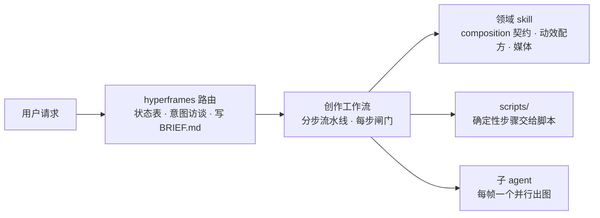

# HyperFrames：用 HTML 做视频

HyperFrames 是 HeyGen 开源的视频渲染框架：一个 composition 就是一个 HTML 文件，用 `data-*` 属性声明时间，动画运行时可以逐帧 seek，由框架截屏编码成 MP4。这里是它随仓库发布的 21 个 AI skill 的完整中译，目录结构、脚本、模板、字体和音效原样随附，AI 顺链接读进来就能照着做视频。如果要调用 2 次以上本 skill 中的脚本，直接将[本 skill](hyperframes.tar.gz)下载到本地。工作流里的脚本基本都成串跑，互相按相对路径 import，`build-frame.mjs` 还跨目录读 `hyperframes-creative/frame-presets/`。

**入口只有一个：[hyperframes](hyperframes/index.md)。** 任何"做个视频"的请求都先读它。它先看项目处在什么状态，新项目就跑一轮意图访谈、写出 `BRIEF.md`，再按路由表把活交给一个创作工作流；工作流按步骤推进、每步过闸门，需要什么技术细节再加载对应的领域 skill。

## 远程使用须知 { #remote-use }

!!! warning "照这几条用，别去装上游原版"

    - **本目录就是完整的 21 个 skill。** skill 之间的引用都解析到这里的同名子目录：`/hyperframes-core` 就是 [hyperframes-core/index.md](hyperframes-core/index.md)，`../hyperframes/references/brief-contract.md` 这类相对路径原样有效。上游的 `SKILL.md` 在这里叫 `index.md`
    - **跳过一切 skill 安装和刷新命令**：`npx hyperframes skills update …`、`npx hyperframes skills`、`npx skills add …`、`skills check`。它们会从 GitHub 装英文原版，跟这里的中译版两套并存、互相打架。工作流开头"先确认 skill 是最新的"那一步直接跳过，读这里的译文即可。`npx hyperframes init` 也会顺手刷新全局 skill，执行时带上环境变量 `HYPERFRAMES_SKIP_SKILLS=1`
    - **CLI 照常用。** `npx hyperframes <命令>` 才是真正干活的工具（init、lint、check、preview、render、capture、tts……），需要 Node.js 22+、FFmpeg 和一个无头 Chrome，缺什么由 `npx hyperframes doctor` 指出
    - **带脚本的步骤要在本地执行。** 只能抓网页的调用方跑不了脚本，只能用纯文字的部分。这是在执行第三方代码，执行前要让用户知情
    - **项目产物文件按英文格式写。** `BRIEF.md`、`STORYBOARD.md`、`SCRIPT.md`、`frame.md` 里的字段名、取值和标题关键字，照各格式文档代码块里的英文原样写，脚本按英文关键字解析；字段里填的内容可以用中文
    - **代码块、模板、脚本都是上游原样**，里面的英文注释和示例没有翻译

## 21 个 skill

### 路由

- [hyperframes](hyperframes/index.md) —— 入口与能力地图：看项目状态续接、跑意图访谈确认 brief、按路由表选定并进入工作流，再按需分派领域 skill

### 创作工作流

- [product-launch-video](product-launch-video/index.md) —— 网站 URL（或脚本、brief）做成产品发布片、宣传片，或用网站自己的截图做导览、展示；最长约 3 分钟，30–90 秒最佳
- [faceless-explainer](faceless-explainer/index.md) —— 任意文字、不抓网站，做成无人出镜讲解视频，画面全由 AI 发明：排版、抽象图形、示意图、数据可视化
- [pr-to-video](pr-to-video/index.md) —— GitHub PR 做成代码变更讲解：更新日志、功能发布、修复、重构
- [embedded-captions](embedded-captions/index.md) —— 给现成口播视频加字幕：逐字 rail 加高潮处嵌入画面，或纯电影感嵌入；原片不动
- [talking-head-recut](talking-head-recut/index.md) —— 给口播、访谈、播客视频叠设计过的图形卡片：动态标题、下三分之一条、数据标注、引语、侧栏、画中画，按转录稿同步；原片不动
- [motion-graphics](motion-graphics/index.md) —— 10 秒以内、无旁白、动效即信息的动态图形：动态文字、数字滚动、图表、logo 片头、下三分之一条，可出透明叠层
- [music-to-video](music-to-video/index.md) —— 一段音乐驱动的卡点视频：歌词、幻灯、动态文字宣传；用户给的图和视频也剪在同一节拍网格上
- [slideshow](slideshow/index.md) —— 演示文稿、路演 deck、可交互 deck：分步揭示、分支、热点导航、演讲者模式；产物是能翻页的 deck，不是渲染出的视频
- [general-video](general-video/index.md) —— 兜底工作流，也是 companion 模式的家：标题卡、品牌片、多场景蒙太奇、循环背景和其他自定义 composition，任意长度
- [remotion-to-hyperframes](remotion-to-hyperframes/index.md) —— 把现成的 Remotion（React）composition 移植成 HyperFrames HTML，单向迁移

### 领域 skill

- [hyperframes-core](hyperframes-core/index.md) —— composition 契约：`data-*` 时间属性、`class="clip"`、track、sub-composition、变量、媒体播放、确定性规则；写 composition HTML 之前必读
- [hyperframes-animation](hyperframes-animation/index.md) —— 全部动画知识：48 条原子动效规则、22 个场景蓝图、转场目录，以及 GSAP、Lottie、Three.js、Anime.js、CSS、WAAPI 等运行时适配
- [hyperframes-keyframes](hyperframes-keyframes/index.md) —— 可 seek 的关键帧写法：推拉镜头、重新构图、路径、遮罩、SVG 描边变形、3D 纵深，以及 `hyperframes keyframes` 诊断
- [hyperframes-creative](hyperframes-creative/index.md) —— 动画之外的创意指导：`frame.md` / `design.md` 设计规范、frame preset、色板、字体、旁白、段落节拍规划、音频驱动的视觉
- [media-use](media-use/index.md) —— 媒体总管：把 BGM、音效、图片、图标、logo、配音、调色、LUT 各种需求落成本地文件和台账记录；目录里没有就调 TTS、音乐、图像模型生成，也管转录、字幕、抠图和跨项目复用
- [hyperframes-audio](hyperframes-audio/index.md) —— 混已经放进 composition 的音频：给旁白挖空 BGM、效果链、自动化包络、多轨共用一条总线
- [hyperframes-cli](hyperframes-cli/index.md) —— CLI 开发循环：init、add、lint、check、snapshot、preview、render、publish、doctor，以及 AWS Lambda 云渲染
- [hyperframes-registry](hyperframes-registry/index.md) —— 检索、安装、接线 registry 里的 block 和 component；手搓任何有名字的效果、转场之前先来这里搜
- [figma](figma/index.md) —— 从 Figma 导入素材、设计 token、组件和分镜画板，重建成动效（画板当状态读，不当幻灯片），外加 Motion 动画和 shader
- [hyperframes-studio](hyperframes-studio/index.md) —— 在 Studio 里陪人做项目：先判断这句话要不要改东西；新片子的计划、分镜和搭建顺序；时间线怎么排才好读（一条字幕轨、一类元素一条轨、每个场景一个 sub-composition）、安全区在哪

每个子 skill 入口末尾的「本 skill 的文件」列出了它目录下的全部文档。

---

维护记录：[从哪来、改了什么](../../maintenance/skills/hyperframes.md)。正常使用不用看，出问题再看。

